# Communication Stack Architecture

This document explains how the HUBUS communication stack is designed and how its layers interact. It complements the normative specs (`PROTOCOL.md`, `ARBITRATION.md`, `MESSAGE_FORMAT.md`, `HARDWARE_REQUIREMENTS.md`) with diagrams. Where this document and a spec differ, the spec wins.

Diagram conventions: Mermaid diagrams render on GitHub; timing diagrams are ASCII (`‾` high, `_` low). On `DATA`, a node pulls the line low for bit `1` and releases it for bit `0`.

## 1. Design in One Page

| Aspect | Decision |
|---|---|
| Topology | One master (Raspberry Pi), up to 63 slaves (ATtiny), two shared wires `CLK` + `DATA`, common GND |
| `CLK` | Push-pull, master only, idles low |
| `DATA` | Open-drain for **every** node incl. master, one external pull-up, wired-AND |
| Bit coding | Low = `1`, released = `0`; set while `CLK` low, sampled on rising edge |
| Framing | START / STOP / RESET are `DATA` edges while `CLK` is high (never occur inside a bit) |
| Philosophy | Slaves are tiny and passive (no timer, no timeout, no retry); the master owns all timing, retries, and recovery |
| Slave → master | Only on request (`REQUEST_DATA`/`INFO`), via arbitration (`POLL_PENDING`), or the idle event handshake |
| Integrity | CRC-8/AUTOSAR over every frame; commands are fire-and-forget, state is read back |

### 1.1 Layer Model

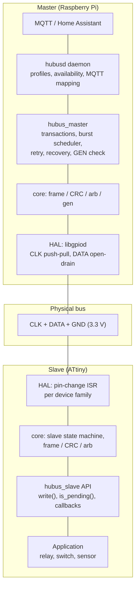

The hardware-independent `core/` is compiled into the master, the slave firmware, and the host tests, so one implementation of framing, CRC and arbitration serves all three. Only the HAL differs (`master/hubus_master_gpiod.c`, `slave/hal/*`, `test/sim/hubus_sim.c`).

### 1.2 Transaction Types

| Transaction | Wire sequence | Purpose |
|---|---|---|
| `SEND_COMMAND` | START · frame · STOP | Command to one slave or a group, never answered |
| `REQUEST_INFO` / `REQUEST_DATA` | START · frame · `T` · slave frame or silence · STOP/RESET | Read static info / read the slave buffer (exact address only) |
| `POLL_PENDING` | START · frame · `T` · 12 arbitration slots · STOP | Find the highest pending MCID in a prefix group |
| RESET | START · STOP | Reset the slaves' communication stack |
| Idle event | slave pulls `DATA` low · master clocks until released | Slave announces new data |

`T` = turnaround slot (one clock period, all nodes released).

## 2. Frame Format

```
 15 14 | 13 12 11   | 10 ........ 5 | 4 ...... 0
 TYPE  | TARGET_LEN | MCID          | LEN            master → slave
 TYPE  | MORE | GEN | MCID          | LEN            slave → master
 byte 0 --------------|-- byte 1 -----------------

 frame = [byte0][byte1][payload: LEN bytes][CRC8]      3 … 34 bytes, MSB first
```

Master types: `00` POLL_PENDING, `01` REQUEST_INFO, `10` REQUEST_DATA, `11` SEND_COMMAND. Slave types start with `1` (`10` SLAVE_DATA, `11` SLAVE_INFO), so a released first bit after `T` means "no response".

Addressing is a prefix mask: a slave matches if its MCID starts with the first `TARGET_LEN` bits of the frame's MCID (`0` = broadcast, `6` = exact). Group/broadcast is strictly one-way.

## 3. Sequence Diagrams

### 3.1 Command with Read-back (relay on)

Commands are never acknowledged. `hubusd` confirms the state by reading it back (`readback: slave`, default).

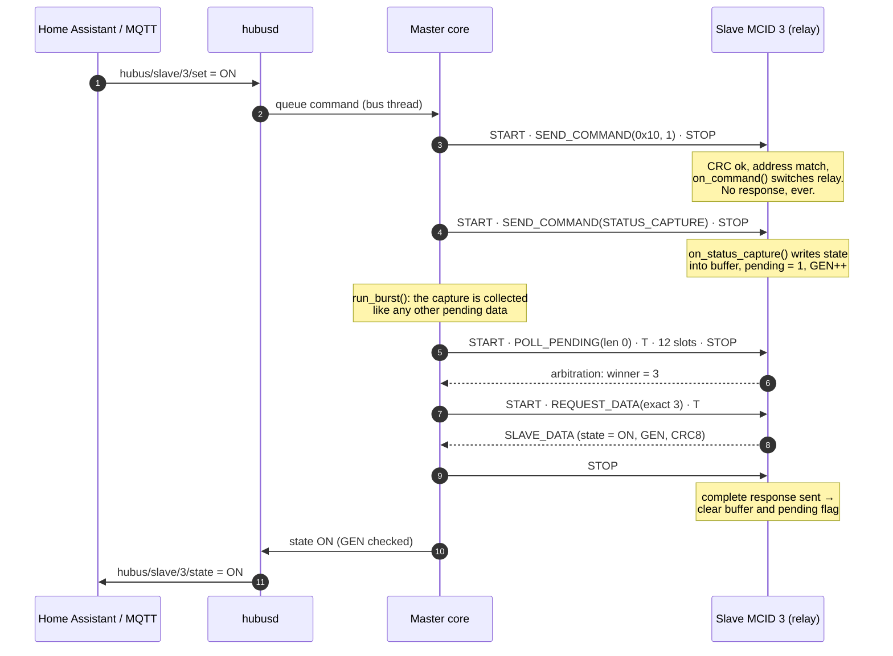

### 3.2 Slave-initiated Event (button) and Burst

```mermaid
sequenceDiagram
    autonumber
    participant B as Switch slave (5)
    participant X as Other pending slave (3)
    participant M as Master
    participant D as hubusd / MQTT

    Note over B: button pressed → hubus_slave_write()<br/>pending 0→1, bus idle, CLK low
    B-->>M: pull DATA low (event signal)
    M->>M: sees DATA low in idle
    loop until DATA released
        M->>B: CLK pulse (confirmation tick)
    end
    B-->>M: release DATA after first falling CLK edge
    Note over M: burst starts, mask stack empty
    M->>B: START · POLL_PENDING(len 0) · T
    B-->>M: arbitration: 12 slots (bit/handoff)
    X-->>M: lost at bit 2 → handoff slot low
    Note over M: winner = 5 (000101); 3 (000011) lost at bit 2<br/>push mask 0000 / len 4 (group MCID 0..3)
    M->>B: STOP, START · REQUEST_DATA(5) · T
    B-->>M: SLAVE_DATA (pressed)
    M->>B: STOP (buffer cleared)
    M->>X: pop mask, POLL_PENDING(prefix) → winner 3
    M->>X: REQUEST_DATA(3) → SLAVE_DATA
    Note over M: stack empty → burst done, CLK low
    M->>D: frames (gen/more/result)
    D->>D: publish state + data topics
```

Within a burst `CLK` stays high after each STOP, so STOP and the next START form one continuous `DATA` rise/fall and no pending slave interrupts with an event signal.

### 3.3 Arbitration with Handoff Slots (the 4-slave example)

Pending: 42 (`101010`), 40 (`101000`), 25 (`011001`), 15 (`001111`).

```mermaid
sequenceDiagram
    participant M as Master
    participant S42 as 42 · 101010
    participant S40 as 40 · 101000
    participant S25 as 25 · 011001
    participant S15 as 15 · 001111

    M->>+S42: POLL_PENDING len 0 (all)
    M-)S15: (same frame, all slaves receive it)
    Note over M,S15: turnaround slot T
    S42-->>M: bit5 = 1 (low)
    S40-->>M: bit5 = 1 (low)
    S25--xS25: bit5 = 0, sees low → lost
    S25-->>M: handoff5 low
    S15-->>M: handoff5 low
    Note over M: push mask "0"/len 1
    Note over M,S15: bit 4, 3, 2 … 42 and 40 equal
    S42-->>M: bit1 = 1
    S40--xS40: bit1 = 0, sees low → lost
    S40-->>M: handoff1 low
    Note over M: push mask "10100"/len 5
    Note over M: winner = 101010 = 42
    M->>-S42: next transaction: REQUEST_DATA(42)
```

Service order: 42, then pop `10100`/5 → 40, pop `0`/1 → 25 (15 loses at bit 4, pushes `00`/2), pop `00`/2 → 15. Four pending slaves cost four polls.

### 3.4 Error Recovery (missing / corrupt response)

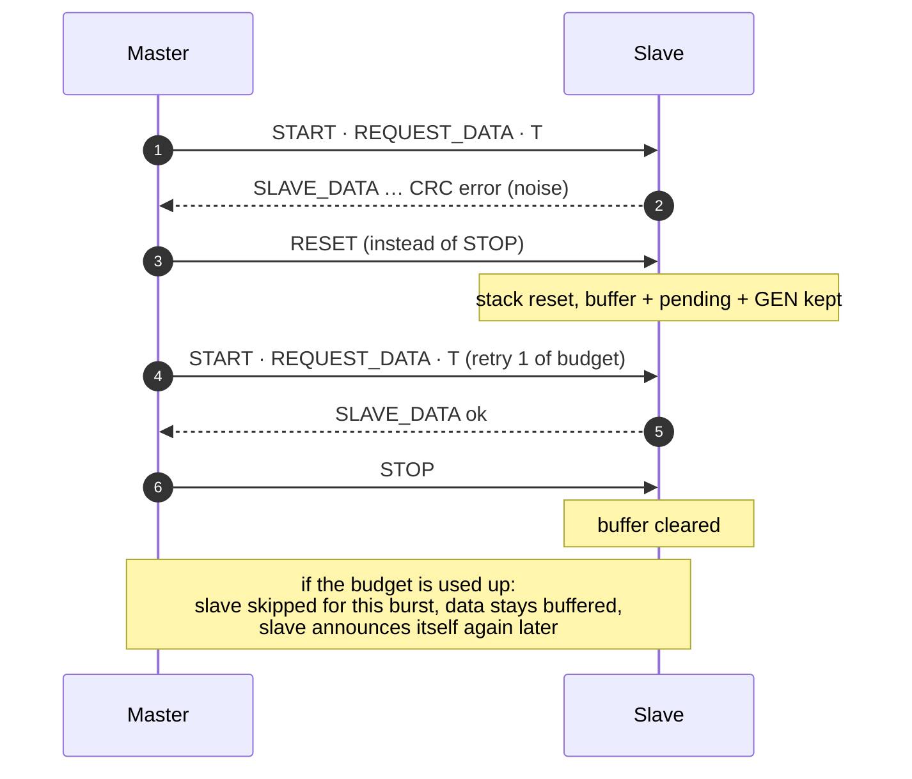

### 3.5 Master Startup

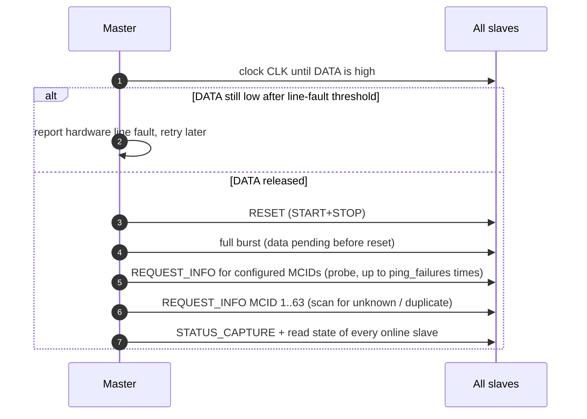

## 4. Activity Diagrams

### 4.1 Master Main Loop (`hubusd_step()`, bus thread)

Mirrors `hubusd_step()` in `daemon/hubusd_core.c`; one pass per call.

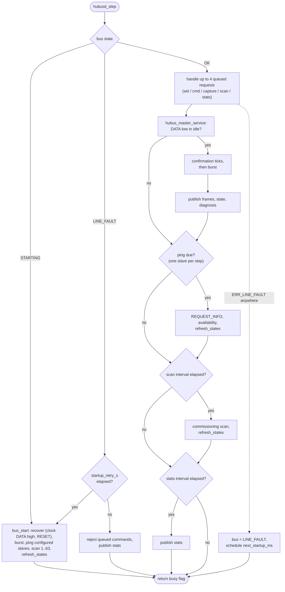

A command with read-back (`readback: slave`) runs `STATUS_CAPTURE` and then a full burst, not a direct `REQUEST_DATA` (see §3.1).

### 4.2 Burst

Mirrors `hubus_master_burst()` and `serve()` in `master/hubus_master.c`.

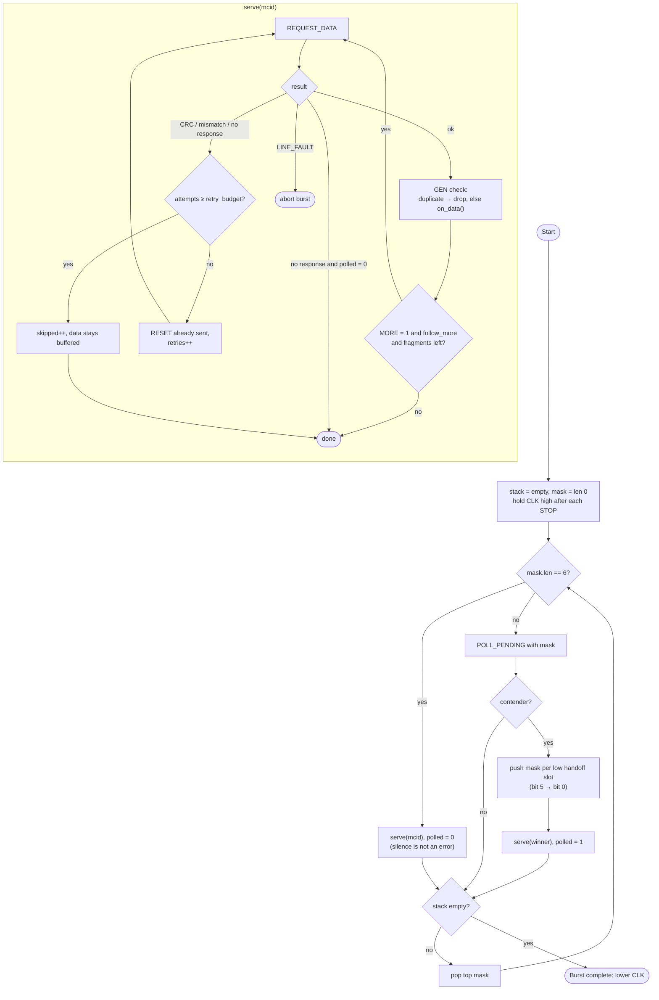

A stack overflow aborts the burst and runs recovery. With the default `retry_budget = 2` a failing slave gets three requests in total.

### 4.3 Slave Reaction to Line Events (ISR logic)

Mirrors `hubus_core_pins()` in `core/hubus_slave_core.c`.

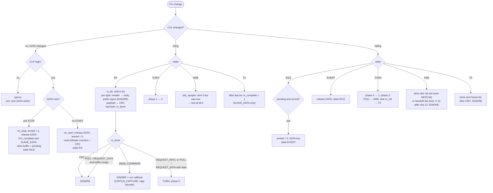

## 5. State Diagrams

### 5.1 Slave Protocol State Machine

States are `HUBUS_ST_*` in `core/hubus_slave_core.h`; the same names are used in `SLAVE_PROPERTIES.md` §2. Transitions follow `core/hubus_slave_core.c`.

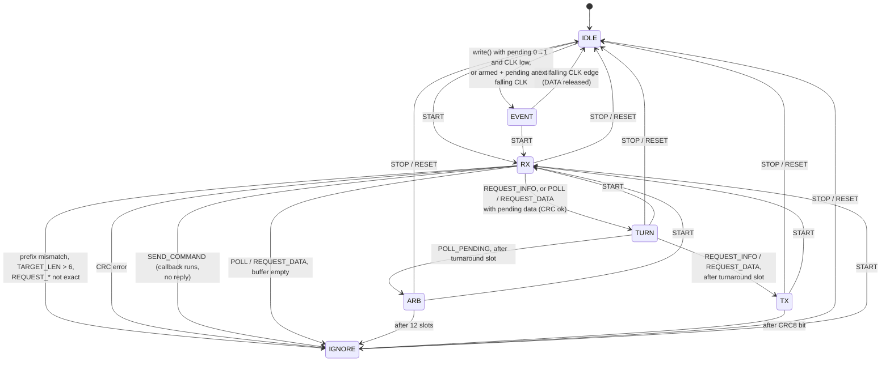

A slave that loses arbitration stays in `ARB` (`arb_active = 0`, `lost = k`), drives the handoff slot `k`, and is passive for the remaining slots. STOP always clears `DATA` and returns to `IDLE` with `armed = 1`; START always resynchronizes. RESET is START immediately followed by STOP, so it needs no code of its own. No transition depends on a timer.

### 5.2 Slave Buffer / Pending Flag

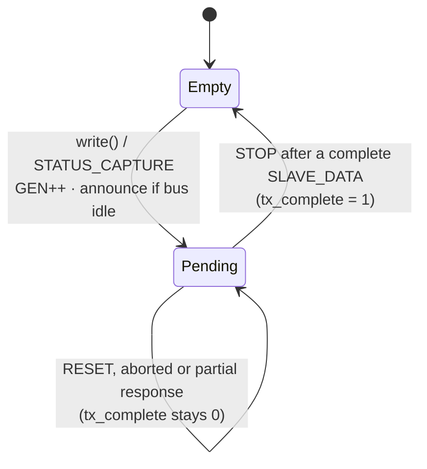

`write()` while a `SLAVE_DATA` frame is being transmitted returns `HUBUS_WRITE_BUSY`, so old and new content never mix.

### 5.3 Master Bus State

The daemon keeps only three bus states (`hubusd_bus_state_t`). The phases inside `HUBUSD_BUS_OK` (idle, event confirmation, burst, transaction, recovery) are not states in the code; they are sequential function calls (`hubus_master_service`, `hubus_master_burst`, `recover`).

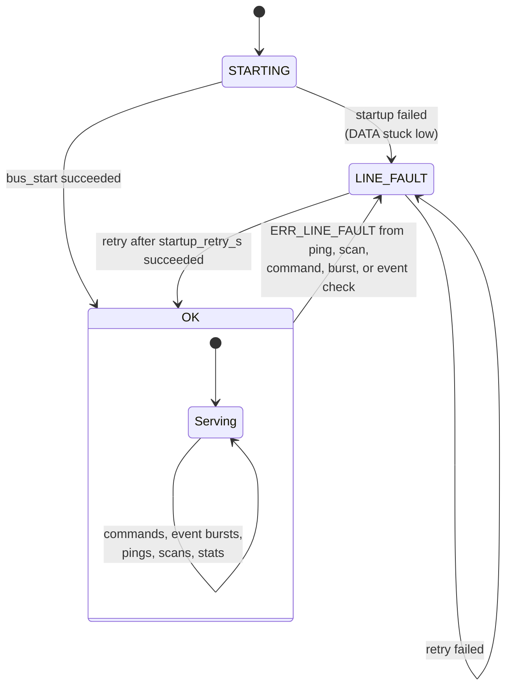

Inside the library every transaction that detects a line error (readback mismatch, STOP not seen) calls `recover()`: clock until `DATA` is high, then RESET. Only if that fails does the error reach the daemon as `LINE_FAULT`.

### 5.4 Slave Availability (daemon view)

`online` in `hubusd_slave_t`: `-1` unknown, `0` offline, `1` online.

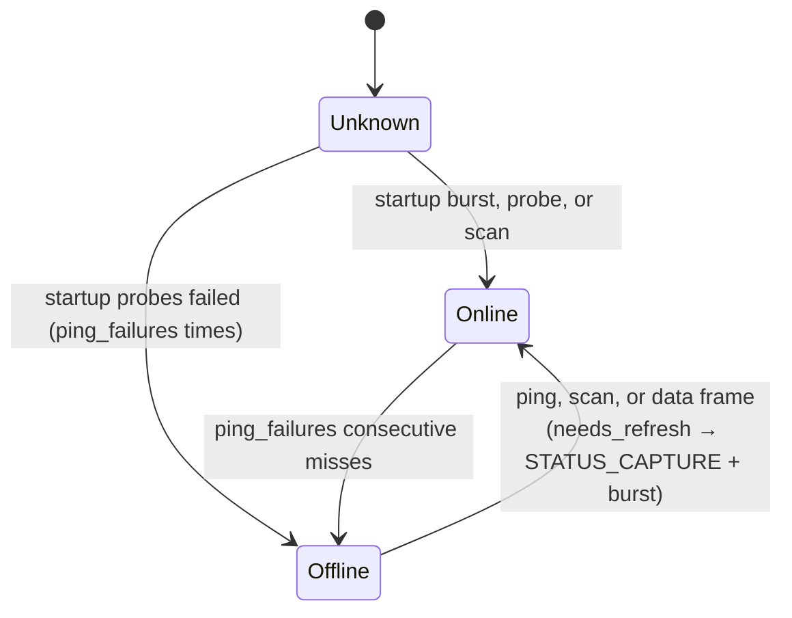

## 6. Timing Diagrams

All timing values are *minimums* set by the master; a slower master only slows the bus. Defaults are conservative placeholders until measured on hardware (`OPEN_ISSUES.md` H3).

### 6.1 Bit Transfer

`DATA` changes only while `CLK` is low and is sampled on the rising edge.

```
          ┌───────┐       ┌───────┐       ┌───────┐
CLK   ____┘       └───────┘       └───────┘       └____
          ↑sample         ↑sample         ↑sample
DATA  ‾‾‾‾‾‾‾‾‾‾‾‾‾‾‾‾‾‾‾‾‾\_______________/‾‾‾‾‾‾‾‾‾‾‾‾‾‾
          bit = 0         bit = 1         bit = 0
          (released)      (pulled low)    (released)
          |<-- T_CLK_LOW ->|   set after falling edge
```

`T_CLK_LOW` must cover the slowest slave's ISR latency plus the time to update `DATA`.

### 6.2 START, STOP, RESET

```
START                          STOP                       RESET
              ┌─────────┐                ┌─────────┐              ┌─────────┐
CLK   ________┘         └___      ________┘         └___   _______┘         └___
DATA  ‾‾‾‾‾‾‾‾‾‾‾‾\_________      __________/‾‾‾‾‾‾‾‾‾‾‾   ‾‾‾‾‾‾‾‾\______/‾‾‾‾‾‾
                  ↑ falls while CLK high      ↑ rises while CLK high   START immediately
                  (all slaves resync)         (bus idle)               followed by STOP
              |<->| T_COND around the DATA edge
```

Sequence for START: raise `CLK`, pull `DATA` low, lower `CLK`, first frame bit follows. STOP: with `CLK` low pull `DATA` low, raise `CLK`, release `DATA`, lower `CLK` (idle). Inside a burst `CLK` is **not** lowered after STOP; the next START follows directly.

### 6.3 `REQUEST_DATA` Transaction (master frame, turnaround, slave response)

```
          START   master frame (header, LEN=0, CRC8)   T     slave frame          STOP
CLK     __┌─┐_┌─┐_┌─┐_ ... _┌─┐_┌─┐_┌─┐_┌─┐_┌─┐_ ... _┌─┐_┌─┐_ ... ┌─┐_┌─┐_ ... ┌─┐__
DATA    ‾‾‾\_[ master drives: bits 15 … 0 | CRC8 ]_‾‾[ slave drives: 1 0 b b … CRC8 ]_/‾‾
              open-drain, master             all     open-drain, selected slave
                                             released
                                    |<- T_TURNAROUND (CLK low) ->|
```

* After the master frame every node releases `DATA` for one slot (`T`). The slave checks CRC, address and buffer state there.
* `CLK` stays low for at least `T_TURNAROUND` before the next rising edge so the slave can prepare its first bit.
* First response bit low → slave frame follows (type starts with `1`). First bit high → no response; the master ends immediately.

### 6.4 Arbitration: 12 Slots

Example `POLL_PENDING len 0` with pending slaves 42 (`101010`) and 25 (`011001`):

```
slot:        T | b5 h5 | b4 h4 | b3 h3 | b2 h2 | b1 h1 | b0 h0 | STOP
CLK      ... ┌┐ ┌┐ ┌┐  ┌┐ ┌┐  ┌┐ ┌┐  ┌┐ ┌┐  ┌┐ ┌┐  ┌┐ ┌┐  (12 pulses after T)
42 drives:   . | L  .  | .  .  | L  .  | .  .  | L  .  | .  .
25 drives:   . | .  L  | L  .  | .  .  | .  .  | .  .  | .  .     (b4: 25 sends 1;
                                                                    h5: lost at bit 5)
DATA bus:    ‾ | \_ /‾\_ ‾‾ ‾‾ \_ ‾‾ ‾‾ ‾‾ \_ ‾‾ ‾‾ ‾‾ ‾‾ | ‾
master sees: - | 1  1  | 0  0  | 1  0  | 0  0  | 1  0  | 0  0
                  ^h5 low → push mask "0"/len 1
winner bits (b5…b0) = 1 0 1 0 1 0 = 42
```

`b` = arbitration slot (contenders with bit `1` pull `DATA` low), `h` = handoff slot (contenders that lost at exactly this bit pull low). The layout is fixed and independent of the line state. After `h0` every slave, including the winner, is passive.

> Note: 25 would only drive `b4` after having lost at `b5`; since it lost it stays passive. The line above is simplified, see §3.3 and `ARBITRATION.md` §7 for the exact per-slot table.

### 6.5 Idle Event Handshake

```
              slave writes buffer          master confirms            next transaction
CLK   _______________________________┌───────┐________________________________┌── (START)
                                      │       │                               │
DATA  ‾‾‾‾‾‾‾‾‾\_______________________________/‾‾‾‾‾‾‾‾‾‾‾‾‾‾‾‾‾‾‾‾‾‾‾‾‾‾‾‾‾‾‾\_
                ↑ slave pulls DATA low         ↑ released after FIRST FALLING CLK edge
                  (CLK low, bus idle)            (not while CLK is high: that would be a STOP)
```

Master side: before every START/RESET (CLK low) check `DATA`; if low, run the handshake first. After raising `CLK` for a START check `DATA` once more: low means a slave started signaling just before the edge (race, `PROTOCOL.md` §7.1); lower `CLK` and repeat the transaction.

### 6.6 Burst on the Wire

```
 | POLL(len 0) | REQUEST_DATA(42) | POLL(10100/5) | REQUEST_DATA(40) | ... | last STOP
 START … STOP ┐ START … STOP    ┐ START … STOP    ┐ START … STOP    ┐ ... STOP
 CLK held HIGH between the transactions (no idle gap, no event signal possible)
 CLK lowered only after the final STOP → bus idle, still-pending slaves signal again
```

## 7. Worst-Case Frame and Transaction Length

Clock periods per transaction (`n` = clock pulses, excluding START/STOP):

| Transaction | Clocks |
|---|---|
| `SEND_COMMAND`, payload `p` bytes | `8·(3+p)` |
| `REQUEST_DATA`, slave payload `q` bytes | `24` (request) `+ 1` (T) `+ 8·(3+q)` |
| `POLL_PENDING` | `24 + 1 + 12 = 37` |
| Largest frame (`LEN=31`) | `34 · 8 = 272` bits |

The library defaults (`hubus_master_cfg_default()`: 50 µs `CLK` low, 50 µs high, 200 µs turnaround) give a 10 kHz clock. A `REQUEST_DATA` with a 1-byte payload then takes `(24 + 1 + 32) × 100 µs ≈ 5.7 ms` plus condition and turnaround overhead; a burst over 4 slaves with 1-byte data is roughly `4 × (37 + 57)` clocks ≈ 38 ms. These are placeholder values until measured on hardware (`OPEN_ISSUES.md` H3).

## 8. Possible Hardware Setup

### 8.1 System Overview

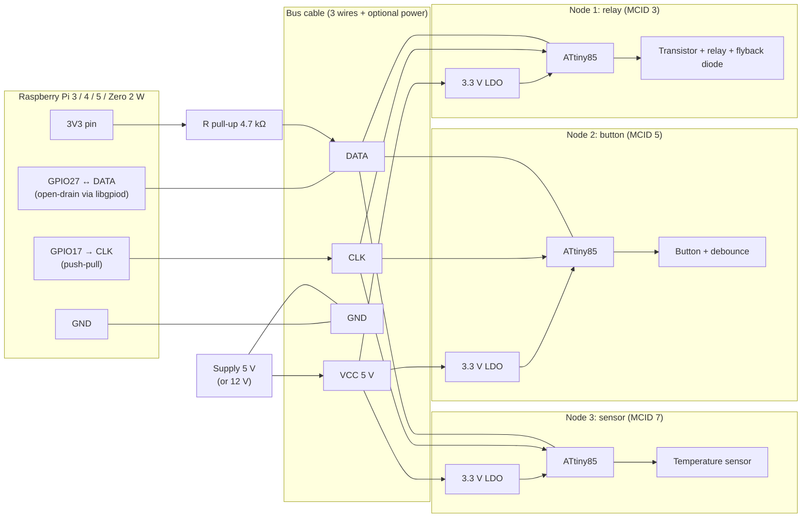

### 8.2 Wiring Schematic (ASCII)

```
                      3V3 (Pi pin 1)
                           │
                         ┌─┴─┐
                         │ R │ 4.7 kΩ pull-up (one for the whole bus)
                         └─┬─┘
 Raspberry Pi              │
 ┌─────────────┐           │
 │ GPIO17 ─────┼──[R 100Ω]─┼───────────────────────┬─────────────────┬──── CLK
 │ GPIO27 ─────┼───────────┴───────────────────────┼─────────────────┼──── DATA
 │ GND ────────┼────────────────────────────────────┼─────────────────┼──── GND
 └─────────────┘                                    │                 │
                                                    │                 │
        ┌───────────────────────────────────────────┘                 │
        │  Slave node (ATtiny85)                                      │ next node …
        │                                                             │
        │            ATtiny85                                         │
        │          ┌────────────┐                                     │
        │  PB5/RST │1          8│ VCC ── 3.3 V ─┬── 100 nF ── GND     │
        │  DATA ───┤2 PB3  PB2 7├─── CLK        │                    │
        │  (PB4)   │3       PB1 6├── (output)  LDO (5 V → 3.3 V)       │
        │  GND ────┤4 GND   PB0 5├── (I/O)                            │
        │          └────────────┘                                     │
        │  PB2 = CLK, PB3 = DATA (default HAL pins, same port/vector) │
        └─────────────────────────────────────────────────────────────┘
```

Pin mapping follows the library defaults for ATtiny25/45/85: `CLK` on `PB2` (pin 7), `DATA` on `PB3` (pin 2). Both pins support pin-change interrupts and share one vector.

### 8.3 Example Node Circuits

**Relay node (MCID 3)**

```
 5 V ──────────────────────────┬──────────────┐
                               │            ┌─┴─┐ relay coil
 5 V → LDO → 3.3 V → ATtiny85  │            │   │   ┌── flyback diode (1N4148)
                               │            └─┬─┘   │
 PB0 ──[1 kΩ]──┐               └──────────────┴─────┘
               │B                              │C
              NPN (BC337 / 2N7000 MOSFET) ──────┘
               │E
              GND
```

The MCU and the bus stay at 3.3 V; the relay coil is switched on the 5 V rail via the transistor.

**Switch node (MCID 5)**: button between `PB0` and GND, internal pull-up on, 10 nF to GND for hardware debounce plus software debounce; pressing calls `hubus_slave_write()`.

**Sensor node (MCID 7)**: ATtiny85 internal temperature sensor (calibration needed) or an external sensor on a free ADC pin (`PB4`; `PB2`/`PB3` carry the bus), read on `STATUS_CAPTURE`.

### 8.4 Bill of Materials (prototype)

| Part | Count | Note |
|---|---:|---|
| Raspberry Pi 3 or newer | 1 | master, `hubusd`, libgpiod v2 |
| ATtiny85 (DIP-8) | per node | 3.3 V supply, internal 8 MHz oscillator |
| Pull-up 2.2 kΩ … 10 kΩ | 1 | `DATA` to 3.3 V; value depends on cable length and node count |
| Series resistor 100 Ω | 1 | optional, on `CLK` at the Pi to damp ringing |
| 100 nF ceramic | per node | decoupling right at VCC/GND |
| 3.3 V LDO (e.g. MCP1700, HT7333) | per node | if a 5 V rail is distributed |
| Transistor + diode + relay | relay node | 5 V load side |
| ISP programmer (USBasp, Arduino-as-ISP) | 1 | flash the nodes |
| 4-wire cable (CLK, DATA, GND, VCC) | – | short, GND mandatory |

### 8.5 Design Rules

- **3.3 V everywhere on the bus.** The Pi GPIO is not 5 V tolerant; a 5 V pull-up would damage it. No level shifters.
- **One pull-up only**, at the master end. Nodes never enable internal pull-ups on `DATA`.
- **Common GND** between master and every node is mandatory.
- Keep `CLK`/`DATA` short; keep them apart from relay or motor wiring.
- Decoupling cap close to every ATtiny.
- Use the slowest node's ISR latency (e.g. 1 MHz parts) to choose the master timing (`T_CLK_LOW`, `T_TURNAROUND`).
- Run the `hubusd` clock thread with real-time priority; jitter only slows the bus, it never breaks the protocol.
- Node count is limited electrically by the single open-drain line (capacitance, pull-up), well below 63 in practice.

### 8.6 Deployment

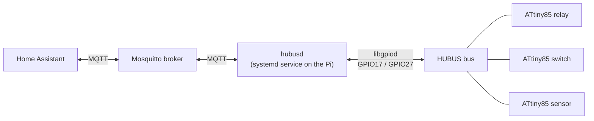

## 9. Where to Find It in the Code

| Concern | Location |
|---|---|
| Frame encode/decode, CRC, arbitration math, GEN | `core/hubus_frame.c`, `hubus_crc.c`, `hubus_arb.c`, `hubus_gen.c` |
| Slave state machine | `core/hubus_slave_core.c` (`HUBUS_ST_*`) |
| Slave API + HAL per family | `slave/hubus_slave.c`, `slave/hal/` |
| Master transactions, burst, recovery | `master/hubus_master.c` |
| Raspberry Pi GPIO | `master/hubus_master_gpiod.c` |
| MQTT daemon | `daemon/` |
| Simulated bus for tests | `test/sim/hubus_sim.c` |
