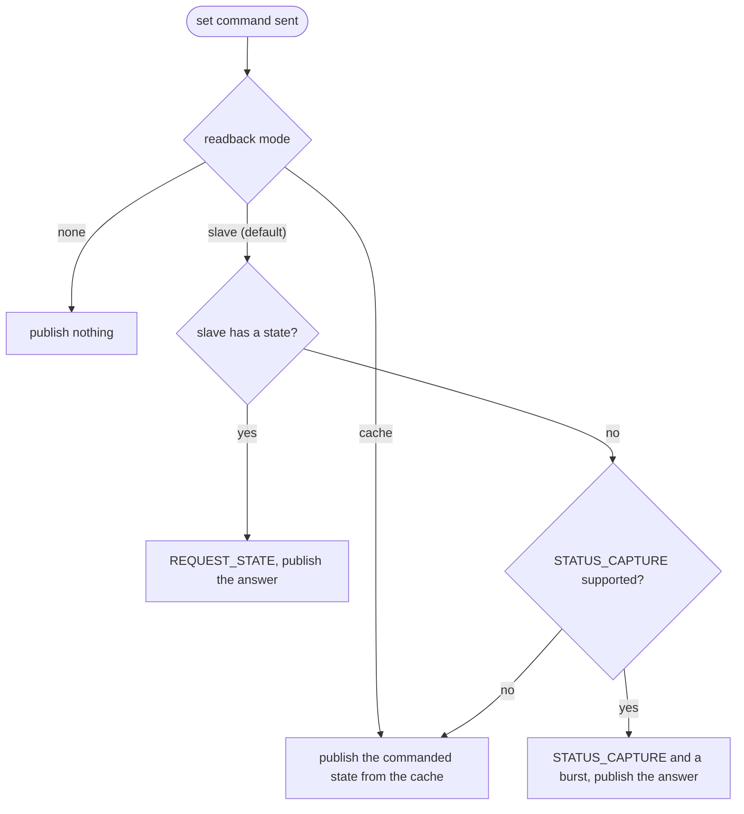
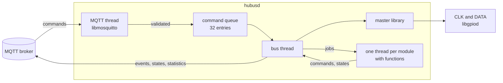

# hubusd: the Bus as an MQTT Service

`hubusd` is the HUBUS master as a long-running Linux service on the Raspberry Pi, in `daemon/`. It runs the bus, publishes events, states, device details, and statistics through MQTT, and executes commands that arrive over MQTT. Home Assistant finds the devices through MQTT discovery.

It is written in C on top of the master library (`master/`) and its libgpiod HAL, uses `libmosquitto` for MQTT and `libyaml` for the configuration, and makes no real-time promises towards MQTT clients: latency is bus latency, milliseconds to a few hundred milliseconds.

Example setup: a Raspberry Pi, a relay (MCID 3), and a push button (MCID 5).

## Install and Start

```sh
cmake --preset host && cmake --build --preset host   # builds build/host/daemon/hubusd
sudo install build/host/daemon/hubusd /usr/local/bin/
sudo install -D daemon/hubusd.example.yaml /etc/hubus/hubusd.yaml
sudo install daemon/hubusd.service /etc/systemd/system/
sudo install -d -m 755 /usr/local/lib/hubus/modules   # optional: module plugins, see modules.dir
sudo useradd -r -G gpio hubus
hubusd --check -c /etc/hubus/hubusd.yaml       # validates the file and prints warnings
hubusd --version                               # prints the version; -v: verbose logging (info messages)
sudo systemctl enable --now hubusd
journalctl -u hubusd -f
```

The service runs as an unprivileged user with access to `/dev/gpiochip*`; real-time priority comes from the capability `CAP_SYS_NICE` in the unit file, not from root. Build dependencies: `libyaml-dev`, `libmosquitto-dev`, and `libgpiod-dev`; `tools/setup-ubuntu.sh` installs them. The daemon is an optional build target: without these libraries the libraries and tests still build.

Without hardware, `build/host/test/hubusd_sim -c config.yaml` runs the same daemon on a simulated bus with a relay (MCID 3), a button (5), a temperature sensor (7), and an unconfigured device (9). Console commands: `press`, `release`, `temp <raw>`, `unplug <mcid>`, `plug <mcid>`, `quit`.

## Configuration

One YAML file, `/etc/hubus/hubusd.yaml` by default (`-c` overrides it); `daemon/hubusd.example.yaml` documents every option. It holds the GPIO chip and lines, the real-time priority, the timing minimums and retry budget of the master, the MQTT broker (host, port, credentials, TLS, base topic, discovery prefix, client id), intervals, the slaves.

- The file is validated at start. Errors name the line, and the daemon refuses to start; unknown keys are warnings.
- The MQTT password can come from `password`, `password_file`, or the environment variable `HUBUSD_MQTT_PASSWORD` (which wins), so the main file can be shared.
- `modules.dir` names a directory of module plugins (`*.so`, [master library](master-library.md#loading-plugins)) for slaves that are not among the built-in ones. They are read at the start and on `SIGHUP`, in the order of their names. A plugin that is invalid, whose name is in use, whose rules conflict with a module that was loaded before, or that others could have changed is refused and logged. Root or the user of the service must own the directory and the files, and nobody else may write them: a plugin runs with the rights of the service. `hubusd --check` loads the plugins too and reports the same.
- `modules.call_timeout_ms` (default 1000, 10 to 60000) is the time limit for one call of a [module function](#module-functions).
- `SIGHUP` (`systemctl reload hubusd`) reloads the slave list, the `bus` section (readback, intervals), `mqtt.stats_interval_s`, `mqtt.discovery`, and the modules. GPIO, timing, and the broker connection need a restart.
- **Reloading the modules:** a plugin whose file is unchanged stays as it is, with its thread and instances. A new or replaced file becomes a new module: hubusd waits until no function of the old one runs (at most 2 s, then it leaves its thread alone), destroys its instances, and creates new ones; its slaves keep running, and their entities are published anew. If a slave would be left without a module, because its plugin is gone or no longer valid, the modules stay as they are and the log says so. Replace a plugin with `install` or `mv` and do not write into it: a file that is written while it is loaded changes the code of the running module, as with any shared library. A module that has failed comes back only with a new file or a restart.

Minimal file for the example:

```yaml
gpio:
  clk: 17
  data: 27
mqtt:
  host: localhost
slaves:
  - mcid: 3
    name: Garden relay
  - mcid: 5
    name: Door button
```

### Timing

The `timing` section configures the clock and the retry behaviour of the master ([§1.4](spec/01-physical-layer.md#14-timing-parameters)). All times are **minimums** in microseconds; the bus can only get slower than configured, never faster.

| Key | Default | Range | Meaning |
|---|---|---|---|
| `clk_low_us` | 50 | 1 to 1000000 | Minimum `CLK` low time (`T_CLK_LOW`). |
| `clk_high_us` | 50 | 1 to 1000000 | Minimum `CLK` high time (`T_CLK_HIGH`). |
| `sample_us` | 25 | 1 to `clk_high_us` | Sample point of `DATA` after the rising edge (`T_SAMPLE`). A larger value than `clk_high_us` is a configuration error. |
| `cond_us` | 50 | 1 to 1000000 | `CLK` high time around the `DATA` change of START and STOP (`T_COND`). |
| `turnaround_us` | 200 | 1 to 1000000 | `CLK` low time after the turnaround slot (`T_TURNAROUND`); raised to `clk_low_us` if smaller. |
| `class_margin_us` | 10 | 0 to 1000000 | Added to the response time of a slave's speed class when that class raises the timing ([below](#speed-classes)). |
| `line_fault_ticks` | 300 | 280 to 65000 | Clock ticks of a `DATA` line stuck low before it is a line fault; at least one maximum frame. |
| `retry_budget` | 2 | 0 to 20 | Retries of a failed `REQUEST_DATA` within a burst. |
| `follow_fragments` | true | true, false | Request the next fragment right after `MORE = 1`. |
| `max_fragments` | 32 | 1 to 255 | Consecutive fragments of one slave per burst. |
| `duplicate_threshold` | 3 | 1 to 100 | Consecutive CRC failures of one MCID that make it a suspect for a duplicate MCID. |
| `line_problem_count` | 3 | 1 to 100 | If more MCIDs than this are suspects at the same time, the diagnosis is a line problem instead of a duplicate MCID. |

The clock period is `clk_low_us + clk_high_us`: 100 µs with the defaults, which is about 10 kbit/s on the wire. The throughput is lower because of the turnaround slots, the arbitration, and the line conditions between transactions. A bit-banged clock in user space only meets the minimums; with `gpio.realtime` set, the scheduling jitter stays small and the real period stays close to the configured one.

To adapt the bus:

- **Slower slaves, long wires, or interference:** raise `clk_low_us` (the slave needs it for its interrupt latency and for updating `DATA`) and `turnaround_us`. Slaves running at 1 MHz are the usual limit; the values must suit the slowest slave on the bus.
- **Faster bus:** lower `clk_low_us`, `clk_high_us`, and `sample_us` together, keeping `sample_us <= clk_high_us`, and watch the statistics for CRC errors ([Statistics and Diagnosis](#statistics-and-diagnosis)).
- The defaults are conservative placeholders until measured on hardware ([open issues](project/open-issues.md#h3-concrete-timing-values)). Changes need a restart of the daemon.

#### Speed Classes

Every slave states in its `SLAVE_INFO` how fast it reacts to the bus, as a speed class with an edge response time `R` ([§1.5](spec/01-physical-layer.md#15-speed-classes)). The master library notes the class of every slave it reads, also of slaves that are not configured or have no module, and raises `clk_low_us`, `clk_high_us`, `cond_us`, and `turnaround_us` to `R` of the slowest one plus `class_margin_us`, each where the configured value is smaller. Class `0` (not declared) and slaves the master has not read yet stand for the configured values.

- The configured values stay the lower limit: a fast slave never makes the bus faster than configured.
- When a slave raises the timing, hubusd logs a warning on `hubus/master/log`, once per change, for example `slave 3 (speed class 4, 362 us) slows down the bus: clock low 372 us, ...`. `hubus/master/state` shows the timing in use under `timing`, and the slave as `limited_by`.
- A class stays known until hubusd restarts, also when the slave goes offline or moves to another MCID: a slow slave that comes back would otherwise be clocked too fast until its `SLAVE_INFO` is read again. After removing a slow slave, restart hubusd to get the faster timing back.
- One slow slave slows down the whole bus, since every slave watches every edge. Clocking only the part of a frame after its address faster is not implemented ([open issues](project/open-issues.md#speed-classes-on-the-master)).

The `gpio` section selects the chip by label (`chip`, preferred) or device path (`path`), the offsets of `clk` and `data` (different lines), `realtime` (`SCHED_FIFO` priority 1 to 99, 0 = off, needs `CAP_SYS_NICE`), and `internal_pullup` (the SoC pull-up on `DATA`, for bench tests only; use an external pull-up).

A slave is recognised by the hardware identifier in its `SLAVE_INFO` ([§4.7](spec/04-frames.md#hardware-identifier-hwid), [types](hwid-types.md)). It selects the slave's module, which states its command size, state, event buffer, blind times, and update support ([§6.10](spec/06-operation.md#610-master-modules)); the modules of the [examples](slave-library.md#examples) are built in, others come as plugins ([`modules.dir`](#configuration)). A slave whose HWID has no module or is invalid is reported and gets no commands. Its module also lists its [entities](#entities), which become its topics and Home Assistant entities. Slaves on the bus that are not configured are ignored: they are logged and listed in `hubus/master/state`, but get no topics and no discovery entries.

## MQTT Topics

`hubus` is the configurable base topic, `<n>` the MCID. Payloads are UTF-8, JSON unless stated otherwise.

### Commands (subscribed)

| Topic | Payload | Effect |
|---|---|---|
| `hubus/slave/<n>/<key>/set` | `ON` / `OFF`, a number, or text | Command to the entity `<key>` of the slave. A switch sends the command stated by its module (relay: opcode `0x10`), and the state is published according to `readback` (below). A switch without fixed commands, a light, a text entity (any text, at most 95 characters), and a number entity (a number within the range of the entity; anything else is refused by hubusd) go to the [functions of the module](#module-functions). |
| `hubus/slave/<n>/<key>/rgb/set` | `r,g,b` | The colour of a light, three numbers `0..255`. |
| `hubus/slave/<n>/cmd` | `0x10 1 2` | Raw command: opcode, then argument bytes (numbers, separated by spaces or commas). Opcode `0x00` (status capture) or `0x10..0xFF`. |
| `hubus/slave/<n>/capture` | any | `STATUS_CAPTURE`: the slave writes its status, the daemon collects and publishes it. |
| `hubus/slave/<n>/read` | any | `REQUEST_STATE`: reads the live state of a slave that has one in one transaction and publishes it. Rejected for slaves without a state. |
| `hubus/slave/<n>/update` | empty, or the name of a module | Starts a [firmware update](#firmware-updates) from the image of the module. Only a trigger: the image never comes over MQTT. |
| `hubus/slave/<n>/mcid` | the new MCID `1..63` | [Changes the MCID](#changing-the-mcid) of the slave through its updater; result on `hubus/master/mcid`. Also for a slave that is not configured, such as a fresh device under the default MCID 63. |
| `hubus/group/<prefix>/<len>/cmd` | as `cmd` | Group (`len` 0..5) or broadcast (`0/0`) command. Slaves never answer group commands; opcode `0` makes a group capture its states, which a burst then collects. |
| `hubus/master/cmd/scan` | any | Commissioning scan ([§6.4](spec/06-operation.md#64-commissioning-scan-and-duplicate-mcids)); result on `hubus/master/scan`. |
| `hubus/master/cmd/probe` | MCID `1..63` | One `REQUEST_INFO` to a single MCID, configured or not; result on `hubus/master/probe`. There is no function that polls all 63 MCIDs. |
| `hubus/master/cmd/stats` | any | Publish the statistics now. |

Every command is validated (MCID range, `TARGET_LEN`, a module for the slave, payload size against the maximum its module states). Slaves never acknowledge commands; an invalid command or one that cannot be executed is reported on `hubus/master/log` and counted in `commands_rejected`.

### Published

| Topic | Retained | Content |
|---|---|---|
| `hubus/master/status` | yes | `online` / `offline` (last will) |
| `hubus/master/state` | yes | bus state (`ok`, `line_fault`), last error, version, configured and online slaves, unknown slaves on the bus, the timing in use (`timing`: `clk_low_us`, `clk_high_us`, `cond_us`, `turnaround_us`, and `limited_by`, the MCID of the slave whose speed class raised it, [speed classes](#speed-classes)) |
| `hubus/master/stats` | no | statistics (below), every `mqtt.stats_interval_s` and on request |
| `hubus/master/diagnosis` | yes | `ok`, `suspected_duplicate_mcid` with the MCIDs, or `line_problem` |
| `hubus/master/scan` | no | result of the last scan |
| `hubus/slave/<n>/firmware` | yes | for a module with a firmware image, in the form of the update entity of Home Assistant: `installed_version`, `latest_version`, `in_progress`, `update_percentage` |
| `hubus/master/probe` | no | result of the last probe: `mcid`, `state` (`present`, `absent`, `suspect` after repeated CRC failures), `configured`, device type, `module`, `state_capable` |
| `hubus/master/mcid` | no | result of the last change of an MCID: `mcid`, `new_mcid`, `result` (`ok`, or why not), timestamp |
| `hubus/master/log` | no | `{level, msg, ts}` for recoveries, offline slaves, rejected commands, unknown slaves |
| `hubus/slave/<n>/availability` | yes | `online` / `offline` |
| `hubus/slave/<n>/info` | yes | from the bus: protocol version, speed class (`speed_class`, [§1.5](spec/01-physical-layer.md#15-speed-classes)), the whole `hwid`, device type, and for the full form `variant`, `firmware`, `revision`, `serial`; `updater`: the updater runs. From the module: `module`, `events`, `status_capture`, `state`, `update`, `max_command`, `blind` ([§7.8](spec/07-slave.md#78-blind-sections)), `module_failed` ([module functions](#module-functions)). And the keys of its `entities`. |
| `hubus/slave/<n>/<key>/state` | yes | value of the entity `<key>` (`ON`/`OFF`, a number), so clients get the last value after a reconnect |
| `hubus/slave/<n>/data` | no | every received frame except duplicates: hex bytes, `gen`, `more`, `result` (`baseline`, `normal`, `wrapped`, `gap`, or `state` for a state read), `lost` buffer contents, timestamp |
| `hubus/slave/<n>/stats` | no | frames, duplicates, gaps, lost contents, CRC errors, missing responses, consecutive failures, last seen |

Try it:

```sh
mosquitto_sub -v -t 'hubus/#'
mosquitto_pub -t hubus/slave/3/set -m ON          # relay on; state ON follows once read back
mosquitto_pub -t hubus/slave/5/capture -n         # read the button state now (STATUS_CAPTURE)
mosquitto_pub -t hubus/slave/7/read -n            # read the live state of the sensor (REQUEST_STATE)
mosquitto_pub -t hubus/master/cmd/probe -m 12     # is anybody at MCID 12?
mosquitto_pub -t hubus/master/cmd/stats -n
```

A button press needs no request: the slave announces it, the daemon collects it in a burst, and `hubus/slave/5/state` becomes `ON`, with the frame on `hubus/slave/5/data`.

## State After a Command (`readback`)

What `hubus/slave/<n>/state` shows after a `set` command is configured globally with `bus.readback` and per slave with `readback:`.



| Mode | Behavior |
|---|---|
| `slave` (default) | The daemon reads the answer from the slave: `REQUEST_STATE` in one transaction if the slave has a state, otherwise `STATUS_CAPTURE` and a burst (two more transactions). The published state is what the slave reports, so a defective slave shows its real state. A slave with neither ([§7.4](spec/07-slave.md#74-optional-parts)) cannot be read back and is treated as `cache`. |
| `cache` | The slave is not contacted again; the daemon publishes the state the command establishes. Fast and without extra bus traffic, but optimistic: a command that did not arrive or was not executed stays unnoticed ([§8.8](spec/08-faults.md#88-commands-without-readback)) until the next event, refresh, or capture. |
| `none` | Nothing is published after the command; the state changes only through events, reads, and captures. |

Raw commands (`cmd` topic) have no known effect and publish no state in `cache` mode. `true`/`false` are accepted as `slave`/`none`.


### Slaves That Are Blind After a Command

A slave with a blind time may ignore the bus for a while after a command to it, for example while it sends a frame to an LED strip ([§7.8](spec/07-slave.md#78-blind-sections)). The daemon takes the time from the slave's module, for every opcode; nothing has to be configured.

- After a command to such a slave, exact or through a group, the daemon waits the blind time of that opcode before it contacts the slave again ([§6.9](spec/06-operation.md#69-blind-time-after-a-command)). The other slaves are served meanwhile.
- With `readback: slave` the readback follows when the blind time is over; `cache` and `none` behave as usual.
- Queued commands, reads, captures, and probes for the slave wait in order; a group command or scan that would include it waits as well. Pings and periodic reads of it are postponed.
- When the time is over, the daemon generates a RESET, which brings the slave back, and then reads it back.
- A `STATUS_CAPTURE` is a command too: the captured status of such a slave arrives with its next announcement after the blind time.

### Slaves That Never Announce Changes (`poll_interval_s`)

A slave without an event buffer, for example a sensor that is only read, never announces a new value ([§6.3](spec/06-operation.md#63-reading-states)). With `poll_interval_s: <seconds>` in its slave entry the daemon reads its state periodically (`REQUEST_STATE`, or `STATUS_CAPTURE` and a burst for a slave without a state) and publishes it. With the default `0` the state is read only at startup, after an outage, after commands, and on the `read` topic.

## Home Assistant

With `mqtt.discovery: true` (default) the daemon publishes retained discovery messages under `<discovery prefix>/<component>/<object>/config` (prefix `homeassistant` by default):

- one entity per entity of the module, of the kind it states: `switch`, `binary_sensor`, `sensor`, `light` (the default schema with `rgb_command_topic`), `text`, or `number` (with `min`, `max`, `step` and a box input), with unit and device class where it has them. Its object id is `hubus_<n>_<key>`; a module with one entity gives it the name of the device, one with several gives each its own name;
- an `update` entity for a slave whose module has a [firmware image](#firmware-updates), with version, progress, and an install button;
- each slave is a device with MCID, firmware version, and serial number, grouped under the **HUBUS master** device and available only while master and slave are online;
- the master device has diagnostic sensors: uptime, bus errors, retries, duplicate frames, lost buffer contents, rejected commands, bus state. The diagnosis is on `hubus/master/diagnosis`.

Removing a slave from the configuration and sending `SIGHUP` removes its entities. `mqtt.discovery_cleanup: true` also clears discovery entries of unconfigured MCIDs at every start.

## Entities

The protocol does not define what payload bytes mean. The module of a slave does: it lists the **entities** of the slave, each with a key, a name, a kind of Home Assistant entity (`switch`, `binary_sensor`, `sensor`, `light`, `text`, `number`), a unit and device class, where its value lies in a frame (offset, 1 or 2 bytes, byte order, sign, `value = raw * scale + add`, decimals), for a number its range, and for a switch the commands for `ON` and `OFF` ([§6.10](spec/06-operation.md#610-master-modules), [master library](master-library.md#master-modules)). hubusd turns every entity into topics under `hubus/slave/<n>/<key>/` and, with discovery, into an entity of Home Assistant. Nothing is configured for it: a new device brings a module with its entities, as a [plugin](master-library.md#loading-plugins).

The modules of the examples are built in:

| Module | Entities |
|---|---|
| `relay`, `relay-simple` | `relay`, a switch (opcode `0x10`, argument `1` or `0`); `relay-simple` has no state to read, so its value comes from the cache ([readback](#state-after-a-command-readback)) |
| `switch`, `switch-update` | `button`, a binary sensor (the first byte of the state) |
| `ledstrip` | `button` as above, `lamp`, a light, and `animation`, a text entity for a formula ([LED strip](example-ledstrip.md#master-side)) |
| `dht11` | `temperature` (°C) and `humidity` (%), sensors read from the state, and `fault`, a binary sensor (`1`: no good reading yet or the last readings failed; [DHT11](example-dht11.md)) |
| `distance` | `distance` (cm, device class `distance`), `near`, a binary sensor, and `threshold`, a number from 0 to 400 cm (default 30) that the module sends to the slave ([distance sensor](example-distance.md)) |
| `motion` | `motion`, a binary sensor with device class `motion` (one byte per event: `1` motion, `0` none; [motion sensor](example-motion.md)) |
| `temperature`, `temperature-passive` | `temperature`, a sensor in °C with device class `temperature`: the raw ADC value of the ATtiny85 internal sensor as `raw - 273`; accurate values need a calibration per device |

A slave without entities stays usable through the raw topics (`data`, `cmd`, `capture`, `read`). The entities of earlier versions had the topics `hubus/slave/<n>/state` and `hubus/slave/<n>/set`; the discovery entries they left are removed by `mqtt.discovery_cleanup: true` at the next start.

### Module Functions

What cannot be described as data is code: a module may have the functions `create`, `destroy`, `on_frame`, and `on_set` ([master library](master-library.md#master-modules)). They are plugin code and could take any time, so they never run on the bus thread.

- **One thread per module that has functions**, started with its first instance; modules without functions cost no thread. The calls of one module run one after the other, in the order of the events. Different modules do not wait for each other.
- **An instance per slave:** created when a slave is configured and its module is known; destroyed when the slave is removed, its module changes, or hubusd stops.
- **`on_frame`** gets every new frame of the slave, also what is read back. A repeated frame is left out. `gap` says that frames were lost before this one, on the bus or in the queue of the module.
- **`on_set`** gets the value of a `set` topic, parsed: a bool for a switch without fixed commands and for the on/off of a light, RGB for the colour of a light, text for a text entity, a number within `min`..`max` for a number entity. A value that cannot be parsed, or that the function refuses, is reported on `hubus/master/log` and counted in `commands_rejected`.
- **A function reaches hubusd only through its host:** `send()`, `set_state()`, and `log()` append to a queue of 64 entries that the bus thread empties. A command then goes through the command queue like any other, with its checks and blind times; while that queue is full, the commands wait in the queue of the module, so a long series is not lost. A function learns from `HUBUS_MODULE_FAILED` that the queue of its module is full.
- **Each module has a queue of 32 jobs.** When it is full, a frame is dropped, counted in `module_jobs_dropped`, and the next frame of that slave has `gap` set; a `set` is rejected. `create` and `destroy` wait for room and are never dropped.
- **A function that does not return within `modules.call_timeout_ms`** stops its module: it is logged, and `module_failed` in `hubus/slave/<n>/info` becomes `true` for all its slaves. The module gets no more calls, so `set` for an entity that needs a function is rejected. What is data keeps working: decoding the entities, fixed commands, blind times. A thread cannot be stopped safely, so it is left alone; only a new plugin file with `SIGHUP` or a restart brings the module back.
- **A crash in a function** ends the service, since plugins run in its process; systemd restarts it, and the startup sequence recovers the bus ([§8.9](spec/08-faults.md#89-master-stops-mid-transaction)).

## Firmware Updates

The firmware of a slave comes with its module: a plugin holds the application image ([master library](master-library.md#firmware-image-in-a-module)), so that module and firmware always fit, and MQTT only triggers the update. Whoever can reach the broker can start an update, but cannot bring in other firmware. Nothing happens by itself. The built-in modules have no image; a slave without one stays with `hubus_master_example update` ([master library](master-library.md#firmware-update)).

- **Trigger:** `hubus/slave/<n>/update`, or the install button in Home Assistant, which sends the name of the module. An empty payload means the module of the slave. A slave that runs an application takes only the image of its own module, and an image of the version it already runs is rejected; another version, also an older one, is loaded. Home Assistant offers an update only if the image is newer.
- **The bus stands still** during an update, about 10 s for 6 KB with the default timing ([§6.8](spec/06-operation.md#68-firmware-update)). Other slaves wait, and their events stay in their buffers. Commands wait in the command queue; what does not fit is dropped and counted in `queue_full`. The progress appears on `hubus/slave/<n>/firmware`.
- **The instance of the module** is destroyed before the update and created anew afterwards, for what the slave then says it is. The entities stay as they are if it keeps its module.
- **If an update fails,** the reason is on `hubus/master/log`, and the slave usually waits in its updater (`updater` in its `info`). Until hubusd restarts, an empty trigger repeats the update.
- **A slave in its updater** no longer says what it is: its hardware identifier is only `0xFF`. After a restart of hubusd the trigger has to name the module: `mosquitto_pub -t hubus/slave/5/update -m my-module`. The updater checks the device signature, if the module states one, but not whether this is the right firmware for the device: choosing the module is up to you.
- **The MCID survives an update:** it is kept in the EEPROM of the slave, which an update does not touch ([slave library](slave-library.md#assigning-the-mcid)).

## Changing the MCID

A slave whose updater takes `UPDATE_SET_MCID` can get another MCID over MQTT ([§6.8](spec/06-operation.md#mcid), [slave library](slave-library.md#changing-the-mcid-over-the-bus)):

```sh
mosquitto_pub -t hubus/slave/63/mcid -m 12   # a fresh device under the default MCID of the updater gets 12
```

- **What happens:** hubusd refuses a new MCID that already answers, switches the slave to its updater, gives it the new MCID, and starts its application again. The bus stands still for about a second. The result is on `hubus/master/mcid` and `hubus/master/log`.
- **hubusd does not write its configuration.** It takes the slave under the new MCID as the configuration has it there: a configured MCID goes into operation with the module of the slave, an MCID outside the configuration is reported as an unknown slave in `hubus/master/state`, with a hint on `hubus/master/log`. The old MCID goes offline; if it is configured, the log says that the configuration still has it. Move the slave in the configuration and reload hubusd (`systemctl reload hubusd`, [above](#configuration)), or add the new MCID before the change, so that the slave goes into operation at once.
- **An application that takes its MCID from elsewhere** (pins, a constant) does not take the new one: hubusd reports `the application takes its MCID from elsewhere`, and the slave keeps its old MCID.
- **A slave in its updater** stays there, under the new MCID; an update that broke off goes on there: `mosquitto_pub -t hubus/slave/12/update -m my-module`.
- Without update support in its module, or with an updater that cannot change the MCID, the slave stays as it was and the reason is reported.

## How It Works



- **Bus thread:** the only thread that touches GPIO and the master library. It executes queued commands (at most four per loop), then serves idle events with bursts, and publishes events, states, and statistics itself through the thread-safe MQTT client. A burst is never interrupted.
- **MQTT thread:** the `libmosquitto` network loop. It validates incoming messages and puts them into the bounded command queue. A full queue drops the command and counts it in `queue_full`; it never blocks the bus thread.
- **Threads of the modules:** run the [functions of a module](#module-functions). They touch neither the bus nor MQTT.
- **Startup:** startup sequence with RESET ([§6.6](spec/06-operation.md#66-startup-shutdown-and-recovery)), a probe of every configured slave, a scan for unconfigured ones ([§6.4](spec/06-operation.md#64-commissioning-scan-and-duplicate-mcids)), a burst for data that was pending, and a state read of every online slave.
- **Availability:** slaves only speak when asked, so the daemon checks every configured slave with `REQUEST_INFO` every `bus.ping_interval_s` (one slave per loop). After `bus.ping_failures` misses a slave is `offline`; when it answers again it is `online`, and its state is read. Valid data frames also count as a sign of life.
- **States and events:** states are read at startup, after an outage, after commands (`readback`), on the `read` topic, and with `poll_interval_s`; events arrive through bursts ([§6.2](spec/06-operation.md#62-burst)). Only slaves with an event buffer take part in a burst.
- **Faults:** a stuck `DATA` line puts the bus into `line_fault` (published with the error); commands are rejected meanwhile, and the startup sequence is retried every `bus.startup_retry_s`. CRC failures are retried within the retry budget; repeated failures of one MCID raise `suspected_duplicate_mcid` in the diagnosis ([§6.4](spec/06-operation.md#64-commissioning-scan-and-duplicate-mcids)).
- **Reconnect:** the MQTT client reconnects by itself and publishes the retained messages (status, state, info, discovery) again on every connection.
- **Shutdown:** `SIGTERM` and `SIGINT` publish `offline`, generate a RESET on the bus, and release the GPIO lines.
- **Logging:** to stderr with syslog priority prefixes for journald; `hubus/master/log` mirrors the important events only.
- **Memory:** independent of bus activity; no unbounded queues and no heap allocation per frame.

### Statistics and Diagnosis

- `hubus/master/stats`: uptime, bursts, group requests (`polls`), requests by type, frames, duplicates, gaps, retries, skipped slaves, commands sent, executed, and rejected, errors by kind (no response, CRC, mismatch, line error, line fault), recoveries, startups, scans, queue depth and overflows, jobs a module could not take (`module_jobs_dropped`), publish errors.
- `hubus/slave/<n>/stats`: see the table above.
- `hubus/master/diagnosis`: the master's duplicate MCID and line problem heuristic ([§6.4](spec/06-operation.md#64-commissioning-scan-and-duplicate-mcids)), also logged when it changes.

## Limits

- The daemon reports only what the protocol carries: `SLAVE_INFO`, states, and event data. Counters inside a slave appear only if its firmware writes them into its event buffer or state.
- The timing defaults are conservative placeholders until measured on hardware ([open issues](project/open-issues.md)).
- Only the libgpiod v2 API is supported.
- Firmware updates ([§6.8](spec/06-operation.md#68-firmware-update)) run only from a [module with an image](#firmware-updates), and the bus stands still meanwhile. For a module without one: stop the service and run `hubus_master_example update <mcid> <file.hex>` ([master library](master-library.md#firmware-update)). The raw `cmd` topic refuses the update opcodes.
- Not yet run on a Raspberry Pi with real slaves; tested against the bus simulation, with a fake MQTT client and end to end with a real broker ([development](development.md#daemon-tests)).
