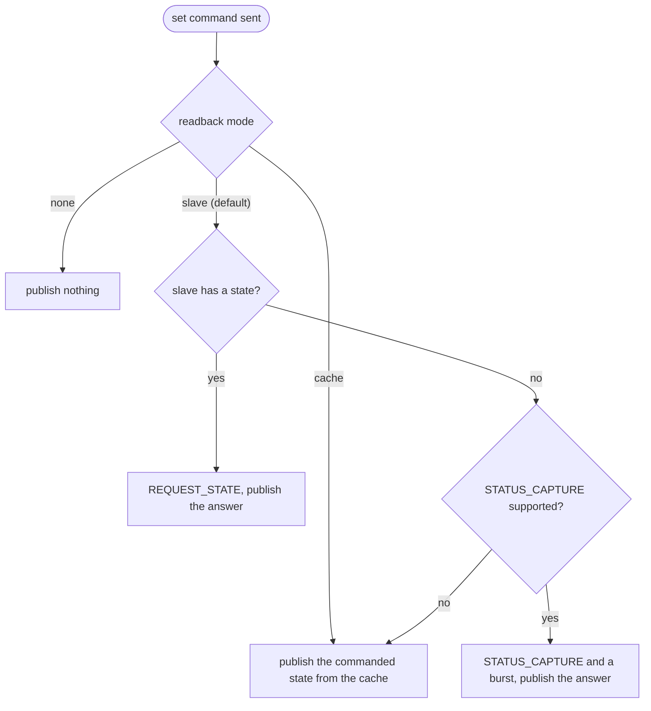
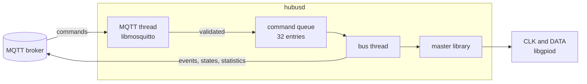

# hubusd: the Bus as an MQTT Service

`hubusd` is the HUBUS master as a long-running Linux service on the Raspberry Pi, in `daemon/`. It runs the bus, publishes events, states, device details, and statistics through MQTT, and executes commands that arrive over MQTT. Home Assistant finds the devices through MQTT discovery.

It is written in C on top of the master library (`master/`) and its libgpiod HAL, uses `libmosquitto` for MQTT and `libyaml` for the configuration, and makes no real-time promises towards MQTT clients: latency is bus latency, milliseconds to a few hundred milliseconds.

Example setup: a Raspberry Pi, a relay (MCID 3), and a push button (MCID 5).

## Install and Start

```sh
cmake --preset host && cmake --build --preset host   # builds build/host/daemon/hubusd
sudo install build/host/daemon/hubusd /usr/local/bin/
sudo install -D daemon/hubusd.example.yaml /etc/hubus/hubusd.yaml
sudo install daemon/hubusd.service /etc/systemd/system/
sudo useradd -r -G gpio hubus
hubusd --check -c /etc/hubus/hubusd.yaml       # validates the file and prints warnings
sudo systemctl enable --now hubusd
journalctl -u hubusd -f
```

The service runs as an unprivileged user with access to `/dev/gpiochip*`; real-time priority comes from the capability `CAP_SYS_NICE` in the unit file, not from root. Build dependencies: `libyaml-dev`, `libmosquitto-dev`, and `libgpiod-dev`; `tools/setup-ubuntu.sh` installs them. The daemon is an optional build target: without these libraries the libraries and tests still build.

Without hardware, `build/host/test/hubusd_sim -c config.yaml` runs the same daemon on a simulated bus with a relay (MCID 3), a button (5), a temperature sensor (7), and an unconfigured device (9). Console commands: `press`, `release`, `temp <raw>`, `unplug <mcid>`, `plug <mcid>`, `quit`.

## Configuration

One YAML file, `/etc/hubus/hubusd.yaml` by default (`-c` overrides it); `daemon/hubusd.example.yaml` documents every option. It holds the GPIO chip and lines, the real-time priority, the timing minimums and retry budget of the master, the MQTT broker (host, port, credentials, TLS, base topic, discovery prefix, client id), intervals, the slaves, and custom profiles.

- The file is validated at start. Errors name the line, and the daemon refuses to start; unknown keys are warnings.
- The MQTT password can come from `password`, `password_file`, or the environment variable `HUBUSD_MQTT_PASSWORD` (which wins), so the main file can be shared.
- `SIGHUP` (`systemctl reload hubusd`) reloads the slave list, the profiles, the `bus` section (readback, intervals), `mqtt.stats_interval_s`, and `mqtt.discovery`. GPIO, timing, and the broker connection need a restart.

Minimal file for the example:

```yaml
gpio:
  clk: 17
  data: 27
mqtt:
  host: localhost
slaves:
  - mcid: 3
    name: Garden relay
  - mcid: 5
    name: Door button
```

Slaves are recognised from the first application byte of their `SLAVE_INFO` (device type 1 relay, 2 switch, 3 temperature, as in the [examples](slave-library.md#examples)), so `profile:` is optional for them. Slaves on the bus that are not configured are ignored: they are logged and listed in `hubus/master/state`, but get no topics and no discovery entries.

## MQTT Topics

`hubus` is the configurable base topic, `<n>` the MCID. Payloads are UTF-8, JSON unless stated otherwise.

### Commands (subscribed)

| Topic | Payload | Effect |
|---|---|---|
| `hubus/slave/<n>/set` | `ON` / `OFF` | Command according to the profile (relay: opcode `0x10`). Afterwards the state is published according to `readback` (below). |
| `hubus/slave/<n>/cmd` | `0x10 1 2` | Raw command: opcode, then argument bytes (numbers, separated by spaces or commas). Opcode `0x00` (status capture) or `0x10..0xFF`. |
| `hubus/slave/<n>/capture` | any | `STATUS_CAPTURE`: the slave writes its status, the daemon collects and publishes it. |
| `hubus/slave/<n>/read` | any | `REQUEST_STATE`: reads the live state of a slave that has one in one transaction and publishes it. Rejected for slaves without a state. |
| `hubus/group/<prefix>/<len>/cmd` | as `cmd` | Group (`len` 0..5) or broadcast (`0/0`) command. Slaves never answer group commands; opcode `0` makes a group capture its states, which a burst then collects. |
| `hubus/master/cmd/scan` | any | Commissioning scan ([§6.4](spec/06-operation.md#64-commissioning-scan-and-duplicate-mcids)); result on `hubus/master/scan`. |
| `hubus/master/cmd/probe` | MCID `1..63` | One `REQUEST_INFO` to a single MCID, configured or not; result on `hubus/master/probe`. There is no function that polls all 63 MCIDs. |
| `hubus/master/cmd/stats` | any | Publish the statistics now. |

Every command is validated (MCID range, `TARGET_LEN`, payload size against the maximum the slave announces). Slaves never acknowledge commands; an invalid command or one that cannot be executed is reported on `hubus/master/log` and counted in `commands_rejected`.

### Published

| Topic | Retained | Content |
|---|---|---|
| `hubus/master/status` | yes | `online` / `offline` (last will) |
| `hubus/master/state` | yes | bus state (`ok`, `line_fault`), last error, version, configured and online slaves, unknown slaves on the bus |
| `hubus/master/stats` | no | statistics (below), every `mqtt.stats_interval_s` and on request |
| `hubus/master/diagnosis` | yes | `ok`, `suspected_duplicate_mcid` with the MCIDs, or `line_problem` |
| `hubus/master/scan` | no | result of the last scan |
| `hubus/master/probe` | no | result of the last probe: `mcid`, `state` (`present`, `absent`, `suspect` after repeated CRC failures), `configured`, device type, `state_capable` |
| `hubus/master/log` | no | `{level, msg, ts}` for recoveries, offline slaves, rejected commands, unknown slaves |
| `hubus/slave/<n>/availability` | yes | `online` / `offline` |
| `hubus/slave/<n>/info` | yes | protocol version, capabilities (`events`, `status_capture`, `state`), accepted command size, application bytes, device type, firmware, serial number, profile |
| `hubus/slave/<n>/state` | yes | interpreted value (`ON`/`OFF`, a number), so clients get the last value after a reconnect |
| `hubus/slave/<n>/data` | no | every received frame except duplicates: hex bytes, `gen`, `more`, `result` (`baseline`, `normal`, `wrapped`, `gap`, or `state` for a state read), `lost` buffer contents, timestamp |
| `hubus/slave/<n>/stats` | no | frames, duplicates, gaps, lost contents, CRC errors, missing responses, consecutive failures, last seen |

Try it:

```sh
mosquitto_sub -v -t 'hubus/#'
mosquitto_pub -t hubus/slave/3/set -m ON          # relay on; state ON follows once read back
mosquitto_pub -t hubus/slave/5/capture -n         # read the button state now (STATUS_CAPTURE)
mosquitto_pub -t hubus/slave/7/read -n            # read the live state of the sensor (REQUEST_STATE)
mosquitto_pub -t hubus/master/cmd/probe -m 12     # is anybody at MCID 12?
mosquitto_pub -t hubus/master/cmd/stats -n
```

A button press needs no request: the slave announces it, the daemon collects it in a burst, and `hubus/slave/5/state` becomes `ON`, with the frame on `hubus/slave/5/data`.

## State After a Command (`readback`)

What `hubus/slave/<n>/state` shows after a `set` command is configured globally with `bus.readback` and per slave with `readback:`.



| Mode | Behavior |
|---|---|
| `slave` (default) | The daemon reads the answer from the slave: `REQUEST_STATE` in one transaction if the slave has a state, otherwise `STATUS_CAPTURE` and a burst (two more transactions). The published state is what the slave reports, so a defective slave shows its real state. A slave with neither ([§7.4](spec/07-slave.md#74-optional-parts)) cannot be read back and is treated as `cache`. |
| `cache` | The slave is not contacted again; the daemon publishes the state the command establishes. Fast and without extra bus traffic, but optimistic: a command that did not arrive or was not executed stays unnoticed ([§8.8](spec/08-faults.md#88-commands-without-readback)) until the next event, refresh, or capture. |
| `none` | Nothing is published after the command; the state changes only through events, reads, and captures. |

Raw commands (`cmd` topic) have no known effect and publish no state in `cache` mode. `true`/`false` are accepted as `slave`/`none`.

### Slaves That Never Announce Changes (`poll_interval_s`)

A slave without an event buffer, for example a sensor that is only read, never announces a new value ([§6.3](spec/06-operation.md#63-reading-states)). With `poll_interval_s: <seconds>` in its slave entry the daemon reads its state periodically (`REQUEST_STATE`, or `STATUS_CAPTURE` and a burst for a slave without a state) and publishes it. With the default `0` the state is read only at startup, after an outage, after commands, and on the `read` topic.

## Home Assistant

With `mqtt.discovery: true` (default) the daemon publishes retained discovery messages under `<discovery prefix>/<component>/<object>/config` (prefix `homeassistant` by default):

- relay profile: `switch`; switch profile: `binary_sensor`; temperature profile: `sensor` with device class `temperature`;
- each slave is a device with MCID, firmware version, and serial number, grouped under the **HUBUS master** device and available only while master and slave are online;
- the master device has diagnostic sensors: uptime, bus errors, retries, duplicate frames, lost buffer contents, rejected commands, bus state. The diagnosis is on `hubus/master/diagnosis`.

Removing a slave from the configuration and sending `SIGHUP` removes its entities. `mqtt.discovery_cleanup: true` also clears discovery entries of unconfigured MCIDs at every start.

## Device Profiles

The protocol does not define what payload bytes mean, so the daemon interprets them with a profile: the built-in `relay` (device type 1), `switch` (2), and `temperature` (3), or custom profiles in the `profiles:` section, without recompiling:

```yaml
profiles:
  dimmer:
    component: switch              # switch | binary_sensor | sensor
    device_type: 0x20              # first application byte of SLAVE_INFO
    on:  {opcode: 0x30, args: [255]}
    off: {opcode: 0x30, args: [0]}
  pressure:
    component: sensor
    byte_offset: 0
    byte_length: 2
    byte_order: big
    scale: 0.1                     # value = raw * scale + offset
    offset: 900
    decimals: 1
    unit: hPa
    device_class: pressure
```

A slave without a profile stays usable through the raw topics (`data`, `cmd`, `capture`). The built-in temperature profile converts the raw ADC value of the ATtiny85 internal sensor as `raw - 273` °C; accurate values need a per-device calibration.

## How It Works



- **Bus thread:** the only thread that touches GPIO and the master library. It executes queued commands (at most four per loop), then serves idle events with bursts, and publishes events, states, and statistics itself through the thread-safe MQTT client. A burst is never interrupted.
- **MQTT thread:** the `libmosquitto` network loop. It validates incoming messages and puts them into the bounded command queue. A full queue drops the command and counts it in `queue_full`; it never blocks the bus thread.
- **Startup:** startup sequence with RESET ([§6.6](spec/06-operation.md#66-startup-shutdown-and-recovery)), a probe of every configured slave, a scan for unconfigured ones ([§6.4](spec/06-operation.md#64-commissioning-scan-and-duplicate-mcids)), a burst for data that was pending, and a state read of every online slave.
- **Availability:** slaves only speak when asked, so the daemon checks every configured slave with `REQUEST_INFO` every `bus.ping_interval_s` (one slave per loop). After `bus.ping_failures` misses a slave is `offline`; when it answers again it is `online`, and its state is read. Valid data frames also count as a sign of life.
- **States and events:** states are read at startup, after an outage, after commands (`readback`), on the `read` topic, and with `poll_interval_s`; events arrive through bursts ([§6.2](spec/06-operation.md#62-burst)). Only slaves with an event buffer take part in a burst.
- **Faults:** a stuck `DATA` line puts the bus into `line_fault` (published with the error); commands are rejected meanwhile, and the startup sequence is retried every `bus.startup_retry_s`. CRC failures are retried within the retry budget; repeated failures of one MCID raise `suspected_duplicate_mcid` in the diagnosis ([§6.4](spec/06-operation.md#64-commissioning-scan-and-duplicate-mcids)).
- **Reconnect:** the MQTT client reconnects by itself and publishes the retained messages (status, state, info, discovery) again on every connection.
- **Shutdown:** `SIGTERM` and `SIGINT` publish `offline`, generate a RESET on the bus, and release the GPIO lines.
- **Logging:** to stderr with syslog priority prefixes for journald; `hubus/master/log` mirrors the important events only.
- **Memory:** independent of bus activity; no unbounded queues and no heap allocation per frame.

### Statistics and Diagnosis

- `hubus/master/stats`: uptime, bursts, group requests (`polls`), requests by type, frames, duplicates, gaps, retries, skipped slaves, commands sent, executed, and rejected, errors by kind (no response, CRC, mismatch, line error, line fault), recoveries, startups, scans, queue depth and overflows, publish errors.
- `hubus/slave/<n>/stats`: see the table above.
- `hubus/master/diagnosis`: the master's duplicate MCID and line problem heuristic ([§6.4](spec/06-operation.md#64-commissioning-scan-and-duplicate-mcids)), also logged when it changes.

## Limits

- The daemon reports only what the protocol carries: `SLAVE_INFO`, states, and event data. Counters inside a slave appear only if its firmware writes them into its event buffer or state.
- The timing defaults are conservative placeholders until measured on hardware ([open issues](project/open-issues.md)).
- Only the libgpiod v2 API is supported.
- Not yet run on a Raspberry Pi with real slaves; tested against the bus simulation, with a fake MQTT client and end to end with a real broker ([development](development.md#daemon-tests)).
