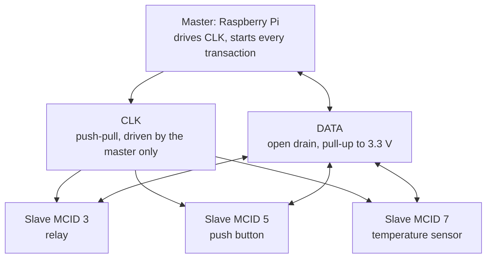
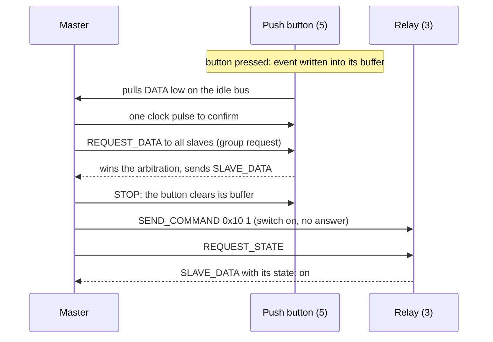

# Overview

HUBUS connects one master, a Raspberry Pi, with up to 63 slaves, small ATtiny microcontrollers, over two lines: a clock that only the master drives, and a shared open-drain data line. Slaves can announce events on their own; the master collects them, reads states and device information, and sends commands.

## Goals

- Run on small 8-bit controllers: the slave library supports classic tinyAVR and tinyAVR 0/1/2-series devices, with the ATtiny85 as the always supported reference.
- No active components on the bus besides the Raspberry Pi and the slave controllers.
- A master clock, so that slaves need no time base.
- Slaves can signal pending communication on the shared data line, and a deterministic arbitration by MCID decides who answers.
- Compact frames by default, with multi-frame transfers for larger data.
- Data integrity and robustness before throughput.

## Design Principles

- **Lightweight slaves, smart master.** Timeouts, retries, scheduling, fault detection, and recovery live on the master. The slave library only implements what cannot move to the master.
- **The master clock is the slave's only time base.** Slaves have no timers and no timeouts; every slave state change is caused by a clock edge or a master line condition.
- **Pragmatic robustness.** Failures that can only occur in rare corner cases and recover at the next master cycle are accepted and documented ([spec §8](spec/08-faults.md)) instead of adding slave complexity.

## System Model

The master starts every transaction. A slave speaks on its own only to announce pending data while the bus is idle; it never sends a frame without being asked.

A typical sequence: a button press is collected, then the master switches a relay and reads its state back.

## The Protocol at a Glance

| Layer | In short | Specification |
|---|---|---|
| Physical layer | `CLK` from the master, `DATA` open drain; `DATA` low = `1`; 3.3 V | [§1](spec/01-physical-layer.md) |
| Line conditions | START, STOP, and RESET are `DATA` changes while `CLK` is high | [§2](spec/02-line-conditions.md) |
| Transactions | command: START · frame · STOP; request: START · frame · turnaround · (arbitration) · response · STOP | [§3](spec/03-transactions.md) |
| Frames | 16-bit header, up to 31 payload bytes, CRC8; four master and two slave message types | [§4](spec/04-frames.md) |
| Arbitration | the higher MCID wins; losers tell the master where they are (handoff slots) | [§5](spec/05-arbitration.md) |
| Operation | idle event handshake, burst, state reads, commissioning scan, startup and recovery | [§6](spec/06-operation.md) |
| Slaves | responsibilities, state machine, optional parts | [§7](spec/07-slave.md) |
| Faults | fault scenarios and accepted rare cases | [§8](spec/08-faults.md) |

## Roles

**Master:** generates the clock and all line conditions, starts every transaction, decides when data is requested, and owns all timeouts, retries, fault detection, and recovery.

**Slave:** listens to the master, announces pending data on the idle bus, takes part in arbitrations, answers only when selected, and reacts only to clock edges and line conditions ([§7](spec/07-slave.md)).

## Key Decisions

The decisions below shape the protocol; [project/decisions.md](project/decisions.md) records why they were taken.

- `DATA` pulled low is `1`, released is `0`; the higher MCID has priority ([§1.2](spec/01-physical-layer.md#12-logic-levels-and-voltage), [§5.1](spec/05-arbitration.md#51-principle)).
- `CLK` idles low; 3.3 V bus without level shifters ([§1](spec/01-physical-layer.md)).
- START and STOP frame every transaction; START immediately followed by STOP is RESET ([§2.1](spec/02-line-conditions.md#21-conditions)).
- Slaves have no timeouts; all timeouts are master-side ([§7.6](spec/07-slave.md#76-no-timeouts)).
- Commands are fire-and-forget; the master verifies a state by reading it back ([§4.4](spec/04-frames.md#44-command-opcodes)).
- A command to a group is one-way; a request to a group is answered by the winner of the arbitration in the same transaction ([§4.5](spec/04-frames.md#45-addressing)).
- Each slave has at most one event buffer, which may be overwritten, and optionally a live state ([§4.8](spec/04-frames.md#48-event-buffer), [§4.10](spec/04-frames.md#410-state)).

## Example Devices

The protocol is generic; these device classes show the intended use:

- **Relay or LED:** receives commands to switch outputs. The master reads the state back with `REQUEST_STATE`. A relay without a state cannot be read back, and the master keeps the commanded state in its cache.
- **Switch or button:** writes changes into its event buffer and announces them; the master collects them in a burst. The level of all inputs is also exposed as its state.
- **Temperature sensor:** exposes its value as its state. A sensor that is only read needs no event buffer, and the master polls it.

Which parts each device needs is described in [§7.4](spec/07-slave.md#74-optional-parts); the [slave library](slave-library.md#examples) has firmware for each of them.

## Implementation

| Part | Directory | Documentation |
|---|---|---|
| Protocol core (CRC, frames, arbitration, slave state machine), shared by master, slaves, and tests | `core/` | this specification |
| Slave library for tinyAVR | `slave/` | [slave library](slave-library.md) |
| Master on a HAL, with the libgpiod HAL for the Raspberry Pi | `master/` | `master/hubus_master.h` |
| `hubusd`, the master as an MQTT service with Home Assistant integration | `daemon/` | [hubusd](daemon.md) |
| Tests, bus simulation, fault injection | `test/` | [development](development.md#tests) |
