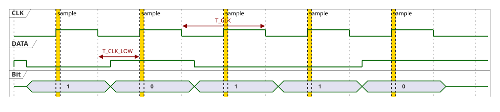

# 1. Physical Layer

Two lines connect the master with all slaves. This chapter defines the lines, the logic levels, and how one bit is transferred; everything above builds on it.

## 1.1 Bus Lines

| Line | Driven by | Driver type | Purpose |
|---|---|---|---|
| `CLK` | master only | push-pull | The only clock of the bus. Low while the bus is idle. |
| `DATA` | every node | open drain (wired-AND), external pull-up | Event signaling, arbitration, and frames in both directions |

- No node ever drives `DATA` high, **the master included**: a node either pulls `DATA` low or releases it, and the pull-up resistor keeps a released line high. Several nodes driving at the same time therefore never cause an electrical conflict, and a change of the transmitting node only requires the previous one to release the line.
- Pull-up for prototypes: 2.2 kΩ to 10 kΩ to 3.3 V, chosen by bus length and node count. The concrete value is still open ([open issues, H3](../project/open-issues.md#h3-concrete-timing-values)).
- There are no transceivers, arbiters, or other active components on the bus; only the master and the slave microcontrollers.
- A common ground between the master and all slaves is mandatory.

## 1.2 Logic Levels and Voltage

- `DATA` pulled low is logical `1`, released (high) is logical `0`. A pulled line dominates a released one, which the arbitration uses ([§5.1](05-arbitration.md#51-principle)).
- HUBUS v0 is a **3.3 V bus**: all slaves are supplied with 3.3 V, the `DATA` pull-up goes to 3.3 V, and `CLK` is a 3.3 V Raspberry Pi output. There are no level shifters, and mixed bus voltages are not allowed.

Rationale: Raspberry Pi GPIOs are not 5 V tolerant, so a 5 V pull-up would damage the master. An ATtiny supplied with 5 V needs about 3.0 V for a valid high input, which leaves no margin for 3.3 V signals; supplied with 3.3 V its threshold is about 2.0 V, and the ATtiny85 still runs from its internal 8 MHz oscillator. Every slave therefore needs a 3.3 V supply (for example a local regulator); loads such as relays may still be switched at higher voltages.

## 1.3 Bit Transfer

- `DATA` changes only while `CLK` is low. A transmitter, master or slave, sets the next bit after the falling `CLK` edge.
- Every node samples `DATA` on the rising `CLK` edge.
- One bit per clock period for every transmitter.

A `DATA` change while `CLK` is high never occurs during a bit transfer; it is reserved for the line conditions of the master ([§2.1](02-line-conditions.md#21-conditions)).

## 1.4 Timing Parameters

The master defines all timing; slaves have no time base and no timing constants of their own.

| Parameter | Meaning |
|---|---|
| `T_CLK` | Clock period. |
| `T_CLK_LOW` | Minimum `CLK` low time. Covers the interrupt latency of the slowest slave plus the time it needs to update `DATA` after the falling edge. |
| `T_SAMPLE` | Sample point of the master after the rising edge. |
| `T_COND` | Minimum `CLK` high time around the `DATA` transition of a line condition ([§2.2](02-line-conditions.md#22-generating-conditions)), so that every slave sees it. |
| `T_TURNAROUND` | Minimum `CLK` low time before the first slot after a turnaround slot ([§3.2](03-transactions.md#32-turnaround-slot)): time for the slave to evaluate the frame and prepare its first bit. |
| line-fault threshold | Number of clock ticks after which a `DATA` line that stays low is a hardware fault; at least one maximum frame length ([§6.6](06-operation.md#66-startup-shutdown-and-recovery)). |

- All values are **minimums**. A slower or jittery clock only slows the bus down; it never violates the protocol. This is what allows a user-space bit-banged master.
- Slaves differ in interrupt latency (device family, CPU clock; some devices run at 1 MHz by default). The master configures the minimums for the slowest slave on the bus.
- A response timeout is not needed: a missing response is visible in the first bit after the turnaround slot ([§3.4](03-transactions.md#34-response-detection)).
- The bus is intentionally moderate in speed. Robust sampling and valid frames take priority over throughput.
- The concrete values are frozen after hardware measurements ([open issues, H2 and H3](../project/open-issues.md)).

## 1.5 Nodes

**Master:** a Raspberry Pi 3 or newer (including Zero 2 W, Pi 4, Pi 400, Pi 5, and the Compute Modules).

- GPIO access through the Linux GPIO character device (`libgpiod`), which works on all these models including the Pi 5 (GPIOs on the RP1 chip). Direct register access and `pigpio` are not used: both are model-specific, and `pigpio` does not support the Pi 5.
- The GPIO chip is selected by its label, not by its number, because the numbering differs between models and kernel versions.
- `DATA` is requested as an open-drain output; the kernel switches between input (released) and output low.
- The clock is bit-banged in user space; real-time scheduling priority for the clock thread is recommended.

**Slaves:** tinyAVR microcontrollers. Supported devices, pins, and resource limits are part of the slave library ([slave library: supported devices](../slave-library.md#supported-devices)).

## 1.6 Layout Notes

- Keep `CLK` and `DATA` short and clean in early prototypes, and add decoupling capacitors near each microcontroller.
- Abnormal line states are resolved by the master (clock ticks, RESET), never by slave timeouts ([§6.6](06-operation.md#66-startup-shutdown-and-recovery)).
- A watchdog in slave firmware is optional and an application matter; it is not part of the protocol.
- Not covered in v0: a PCB reference layout, a signal integrity model, EMI qualification.
