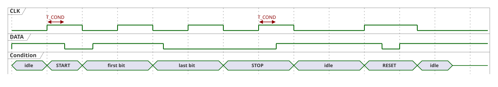
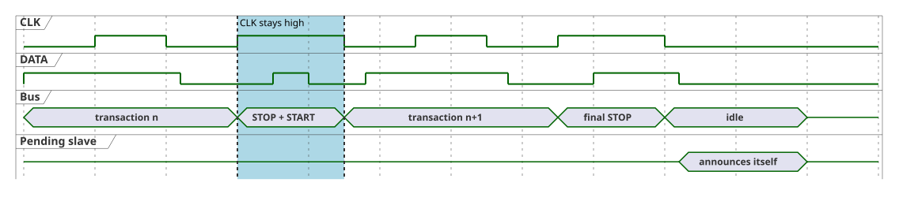

# 2. Line Conditions

Line conditions frame the master's transactions. They are changes of `DATA` while `CLK` is high, which never happen during a bit transfer ([§1.3](01-physical-layer.md#13-bit-transfer)).

## 2.1 Conditions

| Condition | On the line | Meaning |
|---|---|---|
| START | `DATA` falls while `CLK` is high | A transaction begins. Every slave discards any partial receive, arbitration, or transmit state and starts receiving at bit 0. |
| STOP | `DATA` rises while `CLK` is high | The transaction ends ([§3.6](03-transactions.md#36-transaction-end-and-buffer-clearing)). |
| RESET | START immediately followed by STOP, without a clock pulse in between | Resets the communication stack of every slave ([§6.5](06-operation.md#65-communication-stack-reset)). |

Only the master generates line conditions. They are not frame content: RESET in particular is never encoded in a frame, so it works even for a slave that has lost bit synchronization.

## 2.2 Generating Conditions

- **START:** with `DATA` released and `CLK` low, the master raises `CLK`, pulls `DATA` low, and lowers `CLK`. The first frame bit follows.
- **STOP:** with `CLK` low, the master pulls `DATA` low, raises `CLK`, and releases `DATA`. `CLK` is then lowered for idle, or stays high for a back-to-back transaction ([§2.4](#24-back-to-back-transactions)).
- **RESET:** START immediately followed by STOP, without lowering `CLK` in between.

`CLK` stays high for at least `T_COND` before and after the `DATA` transition ([§1.4](01-physical-layer.md#14-timing-parameters)).

## 2.3 Bus Idle

The bus is idle between a STOP or RESET and the next START, with `CLK` low. A slave that pulls `DATA` low while the bus is idle signals an event ([§6.1](06-operation.md#61-idle-event-handshake)); this cannot be mistaken for a START, because `CLK` is low.

## 2.4 Back-to-Back Transactions

STOP leaves `CLK` high until the master lowers it. A master that continues with the next transaction at once, as inside a burst ([§6.2](06-operation.md#62-burst)), keeps `CLK` high and generates the next START directly: `DATA` rises (STOP) and falls again (START) while `CLK` stays high. The bus is never idle in between, and since `CLK` does not fall, no pending slave can announce itself between the transactions ([§6.1](06-operation.md#61-idle-event-handshake)). Only after the final STOP does the master lower `CLK`.

## 2.5 Resynchronization

Every START resynchronizes every slave. A slave that lost track of the bit stream, for example after a lost or an extra clock edge, ignores the rest of that frame (it fails the address match or the CRC check) and is back in sync at the next START ([§8.2](08-faults.md#82-fault-scenarios)).
