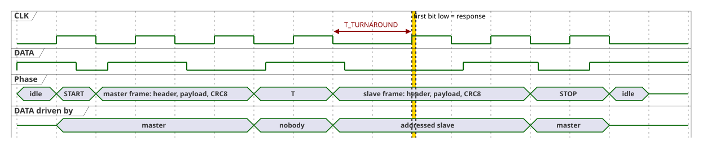

# 3. Transactions

Every exchange on the bus is a transaction that the master starts with START and ends with STOP or RESET. This chapter defines the transaction types, who drives `DATA` when, and how a transaction ends.

## 3.1 Transaction Types

| Transaction | Sequence on the bus |
|---|---|
| Command (`SEND_COMMAND`) | START · master frame · STOP |
| Request, exact (`TARGET_LEN = 6`) | START · master frame · `T` · slave frame or silence · STOP or RESET |
| Request, group (`TARGET_LEN < 6`) | START · master frame · `T` · `2·(6−TARGET_LEN)` arbitration slots · slave frame of the winner or silence · STOP or RESET |
| RESET | START · STOP |
| Idle event handshake | a slave pulls `DATA` low · the master clocks until `DATA` is released · next START ([§6.1](06-operation.md#61-idle-event-handshake)) |

The requests are `REQUEST_STATE`, `REQUEST_INFO`, and `REQUEST_DATA` ([§4.3](04-frames.md#43-master-message-types)); `T` is the turnaround slot ([§3.2](#32-turnaround-slot)).

- Every request that expects a response is **one transaction**, whatever its addressing. With exact addressing at most one slave can answer, and there is no arbitration. With group addressing the matching slaves that can answer arbitrate first, and the **winner answers in the same transaction** ([§5](05-arbitration.md)).
- A command is never answered, also when it is sent to a group ([§4.5](04-frames.md#45-addressing)).
- A slave that is not addressed, has nothing to send, or lost the arbitration ignores everything until the next START, STOP, or RESET.

An exactly addressed request, with the frames shortened to two bits each:

A group request has the arbitration slots between the turnaround slot and the slave frame; [§5.3](05-arbitration.md#53-slot-sequence) shows one.

## 3.2 Turnaround Slot

A turnaround slot (`T`) is one clock period in which every node releases `DATA`; its value is ignored. It is inserted wherever the transmission changes from the master to the slaves, directly after the master frame. The slaves use it to finish evaluating the frame and to prepare their first bit; the master additionally keeps `CLK` low for at least `T_TURNAROUND` before the rising edge of the slot after `T` ([§1.4](01-physical-layer.md#14-timing-parameters)).

## 3.3 Who Drives `DATA`

| Phase | Driven by | Sampled by |
|---|---|---|
| START, STOP, RESET | master | all slaves |
| Master frame | master | all slaves; a slave stops evaluating as soon as the address cannot match ([§4.5](04-frames.md#45-addressing)) |
| Turnaround slot | nobody | – |
| Arbitration slot | contenders whose MCID bit is `1` ([§5.3](05-arbitration.md#53-slot-sequence)) | master and contenders |
| Handoff slot | contenders that lost at exactly this bit ([§5.3](05-arbitration.md#53-slot-sequence)) | master |
| Slave frame | the exactly addressed slave, or the winner of the arbitration | master |

## 3.4 Response Detection

- Both slave type codes start with `1` ([§4.6](04-frames.md#46-slave-message-types)). The first bit of every slave frame is therefore low.
- The master reads the first bit after the turnaround slot, or after the last arbitration slot of a group request. If it is high, there is no response: nobody is addressed, nobody can answer (no state, no pending data), or the request frame was invalid. The master ends the transaction at once.
- In a group request a high first bit means that nobody contended. The arbitration slots alone cannot show this, because the open MCID bits of a single contender may all be `0`.
- Otherwise the master reads the slave header, takes the payload length from `LEN`, and clocks exactly the remaining header, payload, and CRC8 bits.
- The master compares the source MCID of the response with the addressed MCID, or for a group request with the winner MCID (prefix plus the sampled arbitration bits, [§5.4](05-arbitration.md#54-winner)). A mismatch counts as a CRC failure.

## 3.5 Slave Processing Budget

One turnaround slot has to be enough for a slave. No slave step may need bulk processing:

- The CRC8 is computed incrementally, byte by byte, while receiving and while transmitting ([§4.12](04-frames.md#412-integrity-check-crc8)).
- The address match is decided while the header bits arrive ([§4.5](04-frames.md#45-addressing)).
- At the end of the frame only the CRC result and whether the slave can answer (state, pending data) remain to be checked.

## 3.6 Transaction End and Buffer Clearing

There is no acknowledgement in either direction. The master confirms a received `SLAVE_DATA` frame implicitly by the way it ends the transaction:

| The master ends with | Meaning | The slave |
|---|---|---|
| STOP | response received, CRC valid | clears its event buffer and pending flag, if it transmitted a complete `SLAVE_DATA` response to `REQUEST_DATA` (including the CRC8) in this transaction |
| RESET | response missing, incomplete, or invalid | keeps buffer and pending flag ([§6.5](06-operation.md#65-communication-stack-reset)) |

- A STOP after an aborted or partial response clears nothing.
- `SLAVE_INFO` (`REQUEST_INFO`) and state frames (`REQUEST_STATE`) are never cleared; only a complete event frame is.
- After a RESET the master may retry with an exactly addressed `REQUEST_DATA` within its retry budget ([§6.2](06-operation.md#62-burst)).
- The application cannot write the event buffer while a response to `REQUEST_DATA` is being transmitted: the slave library refuses the write, so a frame never mixes old and new content. A write after the complete response but before the STOP is kept; the STOP does not clear content written after the response.
- A STOP that the slave does not see leads to a duplicate delivery, which the master detects ([§8.4](08-faults.md#84-lost-stop)).
