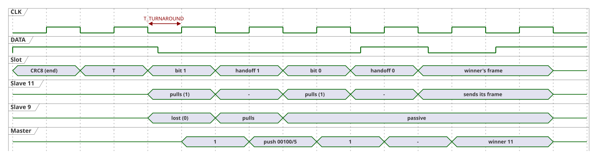

# 5. Arbitration

The arbitration decides which slave answers a group request. Combined with the handoff slots it also tells the master where in the MCID space further slaves are waiting, so that a burst ([§6.2](06-operation.md#62-burst)), a state read ([§6.3](06-operation.md#63-reading-states)), or a commissioning scan ([§6.4](06-operation.md#64-commissioning-scan-and-duplicate-mcids)) can serve all of them in priority order.

## 5.1 Principle

- Contenders send the open bits of their MCID, most significant bit first: `1` by pulling `DATA` low, `0` by releasing it.
- A pulled line dominates a released one ([§1.2](01-physical-layer.md#12-logic-levels-and-voltage)). A contender that sends `0` but samples `DATA` low knows that another contender has a `1` at this bit, and it has lost.
- So the **higher MCID wins**. Priority only decides the order; a burst still serves every slave pending at its start ([§6.2](06-operation.md#62-burst)).
- MCID `0` is reserved: its contender would send only released bits and could not be told from "no contender" ([§4.5](04-frames.md#45-addressing)).

## 5.2 Contenders

A group request (`TARGET_LEN < 6`) with a valid CRC starts an arbitration. A slave contends if it matches the target mask ([§4.5](04-frames.md#45-addressing)) and can answer:

| Request | Contenders |
|---|---|
| `REQUEST_INFO` | every matching slave |
| `REQUEST_STATE` | every matching slave with a state ([§4.10](04-frames.md#410-state)) |
| `REQUEST_DATA` | every matching slave with pending data ([§4.8](04-frames.md#48-event-buffer)) |

The others take no part and stay passive until the next START, STOP, or RESET. An exactly addressed request (`TARGET_LEN = 6`) has no arbitration: the addressed slave answers directly after the turnaround slot.

## 5.3 Slot Sequence

The MCID bits are numbered 5 (MSB) to 0. The first `L = TARGET_LEN` bits are the shared prefix of all contenders and are not arbitrated. Each open bit `k`, from `5−L` down to 0, has two slots:

| Slot | `DATA` pulled low by |
|---|---|
| arbitration slot `k` | every active contender whose MCID bit `k` is `1` |
| handoff slot `k` | every contender that lost at exactly bit `k` |

- The arbitration has `2·(6−L)` slots: 12 for `L = 0`, 2 for `L = 5`, none for `L = 6`. The layout depends only on `TARGET_LEN`, never on the line state: a slave starts at slot `2·L` of the 12-slot pattern.
- It begins directly after the turnaround slot ([§3.2](03-transactions.md#32-turnaround-slot)). The winner sends its frame directly after handoff slot 0.
- A contender whose bit `k` is `0` releases `DATA` and samples it. If it samples low, it has lost at bit `k`: it pulls `DATA` low in handoff slot `k` and stays passive until the end of the transaction.
- All other contenders release the handoff slot and continue. A handoff slot after a released arbitration slot always stays released, since nobody can lose there.
- Nobody can lose within the prefix, which is why those slots are not sent.

Example: a request with prefix `0010` (`L = 4`) and the contenders 11 (`001011`) and 9 (`001001`):

## 5.4 Winner

- The contender that is still active after bit 0 is the winner. Its MCID is the request prefix followed by the bits the master sampled in the arbitration slots.
- The first bit after the arbitration slots shows whether there is a winner at all: every winner sends a frame, and every slave frame starts with a low bit ([§3.4](03-transactions.md#34-response-detection)). A high first bit means no contender. Low arbitration slots alone do not prove a contender, because the open bits of a single contender may all be `0` (for example MCID `101000` answering prefix `10100`).
- Two slaves with the same MCID cannot be told apart: both win and both send their frame. The overlapping frames fail the CRC unless they are identical; duplicate MCIDs are a configuration fault that the master detects ([§6.4](06-operation.md#64-commissioning-scan-and-duplicate-mcids)).

## 5.5 Pending Masks

A low handoff slot `k` tells the master that at least one contender lost at bit `k`. Such a slave shares the winner's bits above `k` and has `0` at bit `k`, so it lies in the group

- prefix: winner bits `5..k+1`, followed by `0` at bit `k`,
- `TARGET_LEN = 6 − k`.

The master pushes this prefix mask onto its pending mask stack and requests the group later ([§6.2](06-operation.md#62-burst)). It pushes the masks in the order of the handoff slots, from bit 5 to bit 0. Masks from lower bits have longer prefixes and cover higher MCIDs, so the stack yields the groups in strictly descending MCID order (last in, first out). The stack holds at most one mask per prefix length, so at most 6 entries; it is master-internal and never transmitted.

A popped mask with `TARGET_LEN = 6` identifies exactly one MCID: the request has no arbitration slots and is a plain exactly addressed request.

## 5.6 Example: Four Pending Slaves

Slaves 42 (`101010`), 40 (`101000`), 25 (`011001`), and 15 (`001111`) have pending data. The master runs a burst ([§6.2](06-operation.md#62-burst)).

**Request 1:** `REQUEST_DATA`, `TARGET_LEN = 0`, 12 slots.

| Bit | 42 | 40 | 25 | 15 | Arbitration slot | Handoff slot | Master |
|---:|:---:|:---:|:---:|:---:|---|---|---|
| 5 | 1 | 1 | 0 | 0 | low | low (25, 15 lost) | push `0` / 1 |
| 4 | 0 | 0 | – | – | high | high | |
| 3 | 1 | 1 | – | – | low | high | |
| 2 | 0 | 0 | – | – | high | high | |
| 1 | 1 | 0 | – | – | low | low (40 lost) | push `10100` / 5 |
| 0 | 0 | – | – | – | high | high | |

Winner `101010` = 42; it sends its frame directly after handoff slot 0. Stack, top first: `10100`/5, `0`/1.

**Request 2:** mask `10100`/5, 2 slots. Only 40 contends. Its last bit is `0`, so both slots stay high, but the first response bit is low: the winner is `10100` + `0` = 40. Stack: `0`/1.

**Request 3:** mask `0`/1, 10 slots. 25 (`011001`) and 15 (`001111`) contend; at bit 4, 25 sends `1` and 15 sends `0`, so 15 loses and drives handoff slot 4: push `00`/2. Winner `0` + `11001` = 25. Stack: `00`/2.

**Request 4:** mask `00`/2, 8 slots. Only 15 contends and wins (`00` + `1111`). The stack is empty; the burst is complete.

Four pending slaves take four transactions, served in the order 42, 40, 25, 15, with 12 + 2 + 10 + 8 = 32 arbitration slots. [§6.7](06-operation.md#67-example-status-capture-and-burst) shows the same burst as a sequence, started by a status capture.
