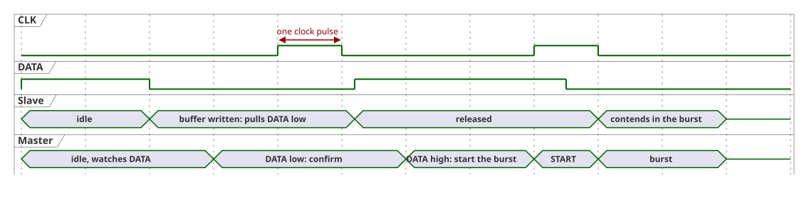
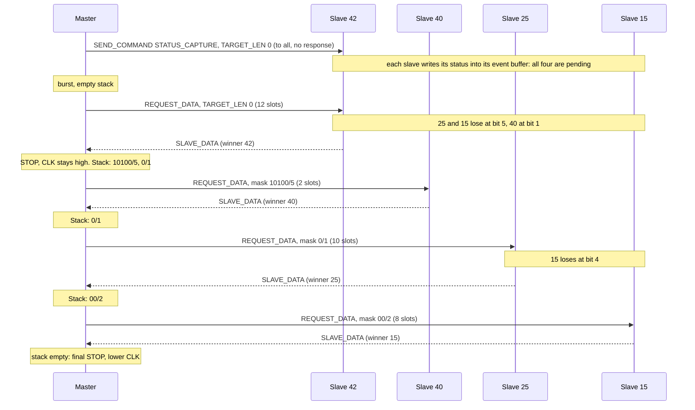
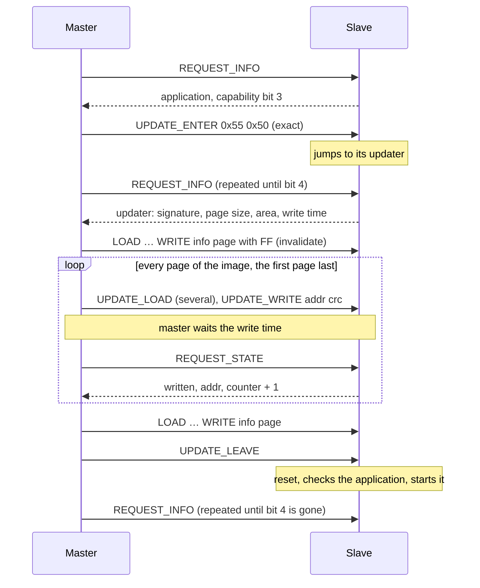

# 6. Operation

This chapter describes the procedures the master runs on top of the transactions: collecting events, reading states, finding slaves, bringing the bus into a defined state, and updating slave firmware. All of them are master-side; a slave only reacts to clock edges and line conditions ([§7.6](07-slave.md#76-no-timeouts)).

## 6.1 Idle Event Handshake

A slave with pending data ([§4.8](04-frames.md#48-event-buffer)) tells the master on its own; this is the only time a slave speaks without being asked.

1. The slave pulls `DATA` low while the bus is idle with `CLK` low ([§2.3](02-line-conditions.md#23-bus-idle)).
2. The master sees `DATA` low while idle and confirms with clock pulses, watching `DATA`.
3. The slave releases `DATA` after the first falling `CLK` edge, that is after one complete clock pulse; releasing while `CLK` is high would look like a STOP. Several slaves that signal at the same time all release after that pulse.
4. The master starts a burst ([§6.2](#62-burst)) with a START.

**When a slave announces itself.** A slave pulls `DATA` low in exactly two situations, both with the bus idle and `CLK` low:

1. The event buffer is written while no data was pending (the pending flag changes from 0 to 1). Overwriting data that is already pending does not signal again.
2. At the first falling `CLK` edge after a STOP or RESET, if data is still pending. This is how a slave that was skipped in a burst, or whose buffer was written during a transaction, announces itself again.

A slave signals at most once per STOP: not again on the clock pulses of a handshake, and never on a falling edge that follows a START. Without this rule, pending slaves in different phases would keep each other's signals alive and the master could never see `DATA` released. Inside a burst `CLK` stays high between the transactions, so nobody signals there at all ([§2.4](02-line-conditions.md#24-back-to-back-transactions)).

**Master side.**

- Before every START or RESET with `CLK` low, the master checks `DATA`. If it is low, it runs the handshake first.
- After raising `CLK` for the condition, it checks `DATA` once more. A slave that started signaling just before `CLK` rose holds `DATA` low ([§8.3](08-faults.md#83-event-signal-races-with-start)). The master completes the clock pulse, which releases the slave, runs the recovery sequence ([§6.6](#66-startup-shutdown-and-recovery)), and repeats the transaction.
- If `DATA` stays low beyond the line-fault threshold, the master reports a line fault ([§6.6](#66-startup-shutdown-and-recovery)).
- The slave has no timeout: without a running master it keeps `DATA` low indefinitely. This is harmless; the startup sequence resolves it ([§6.6](#66-startup-shutdown-and-recovery)).

## 6.2 Burst

A burst collects the data of every slave that is pending when it starts, in descending MCID order, with exactly one transaction per slave: a group `REQUEST_DATA` whose winner sends its data directly ([§5](05-arbitration.md)).

1. Start with an empty pending mask stack and send `REQUEST_DATA` with `TARGET_LEN = 0`.
2. If the first bit after the arbitration slots is high, the group has no pending slave. Otherwise the winner is the group prefix followed by the sampled arbitration bits, and the master pushes one mask per low handoff slot ([§5.5](05-arbitration.md#55-pending-masks)).
3. The winner's frame follows in the same transaction. If it is valid, the master ends with STOP and the winner clears its buffer ([§3.6](03-transactions.md#36-transaction-end-and-buffer-clearing)). If not, it ends with RESET and retries the winner with an exactly addressed `REQUEST_DATA`; the masks are already on the stack.
4. While the stack is not empty, pop the top mask and continue with step 2. A mask with `TARGET_LEN = 6` is a plain exact request.

Properties:

- All transactions of a burst are back-to-back with `CLK` held high ([§2.4](02-line-conditions.md#24-back-to-back-transactions)). The master lowers `CLK` only after the final STOP; slaves that are still or again pending then announce themselves ([§6.1](#61-idle-event-handshake)).
- Every slave pending at the start is served in this burst. A higher-priority slave that becomes pending again during the burst lies outside the remaining masks and is served in the next burst, so lower-priority slaves are not starved.
- The slave's effort is one extra pulled slot, the handoff slot directly after losing.
- A failed slave is retried within a small configured budget and then skipped for this burst. Its data stays buffered, and it announces itself again later.
- A wrongly read handoff slot only wastes a request or delays a slave to the next burst ([§8.5](08-faults.md#85-handoff-slot-errors)).
- After a valid fragment with `MORE = 1` the master may ask the same slave again at once ([§4.11](04-frames.md#411-fragments)).

[§5.6](05-arbitration.md#56-example-four-pending-slaves) walks through a burst with four slaves; [§6.7](#67-example-status-capture-and-burst) shows it as a sequence.

## 6.3 Reading States

- An exactly addressed `REQUEST_STATE` reads the live state of one slave at any time, in one transaction ([§4.10](04-frames.md#410-state)). Nothing is cleared, so it can be repeated freely; it does not disturb pending events.
- A group `REQUEST_STATE` (for example `TARGET_LEN = 0`) enumerates the states of all slaves that have one, one transaction per slave, with the same mask stack algorithm as a burst ([§6.2](#62-burst)).
- A slave without an event buffer never announces a change. A master that needs current values polls its state (for example `poll_interval_s` in [hubusd](../daemon.md#slaves-that-never-announce-changes-poll_interval_s)).
- A slave without a state can still be read with `STATUS_CAPTURE` followed by a burst. That takes more transactions and goes through the event buffer, where the captured status may overwrite an unread event ([§4.8](04-frames.md#48-event-buffer)).
- A slave with neither a state nor an event buffer cannot be read at all; the master keeps the state it commanded ([§8.8](08-faults.md#88-commands-without-readback)).

## 6.4 Commissioning Scan and Duplicate MCIDs

Duplicate MCIDs are a configuration fault. Only the master detects them; slaves implement no detection logic.

**Commissioning scan.** The master enumerates the slaves with group `REQUEST_INFO`, using the burst algorithm ([§6.2](#62-burst)) with `REQUEST_INFO` instead of `REQUEST_DATA`. Every matching slave contends, so the winner's `SLAVE_INFO` arrives in the same transaction: about one transaction per slave, and empty MCID groups are never visited.

- A valid `SLAVE_INFO`: the slave is present; its protocol version and capabilities are known ([§4.7](04-frames.md#47-slave-info-slave_info)).
- No contender: no slave in that group.
- Repeated CRC failures for a winner: suspected duplicate MCID or a line problem. The master repeats the request for that MCID with exact addressing within its retry budget.

Two slaves with the same MCID win an arbitration together and both send their frame; the overlapping frames fail the CRC if their contents differ. With a device-unique value in `SLAVE_INFO` ([§4.7](04-frames.md#47-slave-info-slave_info)) the scan therefore detects duplicates reliably.

A single MCID can be checked at any time with an exactly addressed `REQUEST_INFO`. There is no procedure that asks all 63 MCIDs one by one.

**Runtime heuristic.** If the same MCID fails the CRC repeatedly while other MCIDs answer cleanly, the master reports a suspected duplicate MCID; repeated failures of many MCIDs point to a line problem instead. Blind spots are described in [§8.7](08-faults.md#87-duplicate-mcid-blind-spots).

## 6.5 Communication Stack Reset

RESET ([§2.1](02-line-conditions.md#21-conditions)) resets the communication stack of every slave:

| Reset | Preserved |
|---|---|
| protocol state (back to idle) | event buffer content |
| receive position, partial frame | generation counter `GEN` |
| arbitration state | pending flag |
| transmit position, partial response | static device info, MCID, application state |
| `DATA` driver (released) | |

Because the pending flag survives, a slave with unread data announces itself again after the reset ([§6.1](#61-idle-event-handshake)).

## 6.6 Startup, Shutdown, and Recovery

**Startup (mandatory).**

1. Clock `CLK` until `DATA` is high. A slave that is still transmitting or arbitrating finishes within one maximum frame length; a slave that signals an event releases on the confirmation pulses.
2. If `DATA` is still low after the line-fault threshold (at least one maximum frame length in clock ticks), report a hardware line fault.
3. Generate RESET ([§6.5](#65-communication-stack-reset)).
4. Run a full burst ([§6.2](#62-burst)) for the data that was pending before.

**Recovery.** Whenever the master detects a fault (missing or invalid response, MCID mismatch, unexpected line state), it runs steps 1–3 and continues. Since every START resynchronizes the slaves anyway ([§2.5](02-line-conditions.md#25-resynchronization)), the explicit RESET matters mainly where a slave may still be transmitting or arbitrating.

**Shutdown (optional).** The master SHOULD generate RESET before it stops, leaving every slave idle with `DATA` released. Slaves do not depend on this, since the master may stop unexpectedly ([§8.9](08-faults.md#89-master-stops-mid-transaction)).

## 6.7 Example: Status Capture and Burst

The four slaves of [§5.6](05-arbitration.md#56-example-four-pending-slaves) support `STATUS_CAPTURE`. The master asks all of them for their status and collects it in one burst:

- The capture command reaches all four slaves; none of them answers it ([§4.5](04-frames.md#45-addressing)). Slaves without `STATUS_CAPTURE` or without event buffer ignore the opcode ([§4.4](04-frames.md#44-command-opcodes)).
- Each request goes to the group of its mask, and only pending slaves of that group contend; the arrows point to the winner.
- A captured status may still be overwritten by a newer write before the master collects it; the master sees that as a `GEN` gap ([§4.9](04-frames.md#49-generation-counter-gen)).

## 6.8 Firmware Update

A slave MAY be able to receive a new application over the bus. This is an optional part ([§7.4](07-slave.md#74-optional-parts)): it needs a second firmware on the device, the **updater**, which takes the new application page by page and writes it into flash. Devices without enough flash leave it out; a slave announces in `SLAVE_INFO` byte 1 which side it is ([§4.7](04-frames.md#47-slave-info-slave_info)):

| Capability bit | Meaning |
|---|---|
| 3, update | The running application switches to its updater on `UPDATE_ENTER`. |
| 4, updater | The updater is running and takes the update commands. |

A slave never sets both. The updater is a slave like any other: same MCID, same protocol, no event buffer, a state, and its own `SLAVE_INFO`.

### Commands

| Opcode | Name | Arguments | Taken by | Effect |
|---|---|---|---|---|
| `0x01` | `UPDATE_ENTER` | `0x55 0x50` | application (bit 3) | Switch to the updater at once. Only with exact addressing (`TARGET_LEN = 6`) and exactly these two key bytes; otherwise ignored. |
| `0x02` | `UPDATE_LOAD` | `offset data…` | updater | Copy `data` into the page buffer at `offset`. A load that does not fit into the page is ignored. |
| `0x03` | `UPDATE_WRITE` | `addr_hi addr_lo crc_hi crc_lo` | updater | Write the page buffer to the flash page at byte address `addr`, after the STOP of the transaction. |
| `0x04` | `UPDATE_LEAVE` | – | updater | Reset after the STOP of the transaction; the updater then starts the application if it is valid. |

- Every other slave ignores these opcodes as unknown reserved opcodes ([§4.4](04-frames.md#44-command-opcodes)), so a misdirected command does no harm. An application without bit 3 ignores `UPDATE_ENTER`; the updater ignores `0x10..0xFF`.
- The exact addressing and the key keep a broadcast or a stray frame from switching slaves into their updaters.
- `UPDATE_WRITE` checks before writing: `addr` is the start of a page inside the application area, the CRC-16 ([below](#integrity)) of the whole page buffer equals `crc`, and with the reset vector rule the page at address 0 starts with the required jump. Otherwise nothing is written.
- A flash write halts the CPU on classic tinyAVR devices. The updater writes only after the STOP, and the master keeps the bus quiet for the write time the updater announces: no clock, no transaction.

### Updater Information

The application bytes of the updater's `SLAVE_INFO`, multi-byte values big-endian:

| Byte | Content |
|---|---|
| 0–2 | Device signature, for example `1E 93 0B` for the ATtiny85 |
| 3 | Flash page size in bytes; `0` means 256 |
| 4–5 | First byte of the application area |
| 6–7 | Size of the application area in bytes, including the info page |
| 8 | Write time in milliseconds: how long the master waits after `UPDATE_WRITE` |
| 9 | Flags: bit 0 = reset vector rule (below) |
| 10–11 | Byte address of the updater |
| 12 | Updater version |

The state of the updater (`REQUEST_STATE`) has four bytes: the result of the last `UPDATE_WRITE` (`0` none yet, `1` written, `2` CRC mismatch, `3` address outside the application area or not page-aligned, `4` reset vector rule violated), its address (2 bytes), and a counter that increments with every executed `UPDATE_WRITE`. The counter tells the master whether its write was executed at all.

### Info Page

The last page of the application area describes the application; the rest of the page is `FF`.

| Byte | Content |
|---|---|
| 0–1 | `48 42` (`HB`) |
| 2–3 | Length of the application in bytes, from the start of the area |
| 4–5 | CRC-16 over the application as stored in flash |
| 6–7 | Word address of the application's reset code |

At every reset the updater checks the info page: the magic bytes, a length that fits in front of the info page, an entry inside the application, and the CRC-16 over the stored application. If all of it holds, it jumps to the entry; otherwise it stays and waits for the master. An application that is incomplete or damaged therefore never starts, and the slave always remains reachable through its updater.

**Reset vector rule** (flag bit 0). On classic tinyAVR the interrupt vector table at address 0 belongs to the application, and the device always starts at address 0. The first word of the application area is therefore a relative jump (`RJMP`) to the updater, and the application's own reset target goes into the info page. The master replaces the first word of the image and computes the entry; the updater refuses a first page without this jump.

### Procedure

1. The master reads `SLAVE_INFO`. With bit 3 it sends `UPDATE_ENTER` and asks again until the updater answers (bit 4); with bit 4 the updater already runs.
2. It checks the image against the updater information: signature, size (at most the application area without the info page), and with the reset vector rule a first word that is an `RJMP`.
3. It writes the info page with `FF` first: from now on the old application is invalid, and an interruption leaves the slave in its updater.
4. It writes every page of the image, the first page last, and after each write reads the state: the result must be `1`, the address that of the page, and the counter one higher than before. Otherwise it loads and writes the page again, within its retry budget.
5. It writes the info page, sends `UPDATE_LEAVE`, and asks for `SLAVE_INFO` until the application answers. If the updater answers again, `UPDATE_LEAVE` was lost or the application did not check out; the master repeats `UPDATE_LEAVE` within its retry budget and otherwise reports the failure.

The master owns the bus during an update. Other slaves keep their pending data and announce it afterwards ([§6.1](#61-idle-event-handshake)).

### Integrity

Pages and the application are protected by CRC-16/CCITT-FALSE (polynomial `0x1021`, initial value `FFFF`, no final XOR, not reflected, check value `29B1` for ASCII `"123456789"`), on top of the CRC8 of every frame. A lost or corrupted `UPDATE_LOAD` shows as a CRC mismatch of the page, a lost `UPDATE_WRITE` as an unchanged counter; both lead to a repeated page. The CRC-16 over the whole application at every reset also catches pages the master never wrote and later flash corruption.

### MCID

The updater answers to the MCID of the application. The application hands it over when it switches; the updater keeps it for the next time it starts without a valid application. How it keeps it is up to the implementation; the HUBUS updater uses the last byte of the EEPROM ([slave library](../slave-library.md#firmware-update)).
