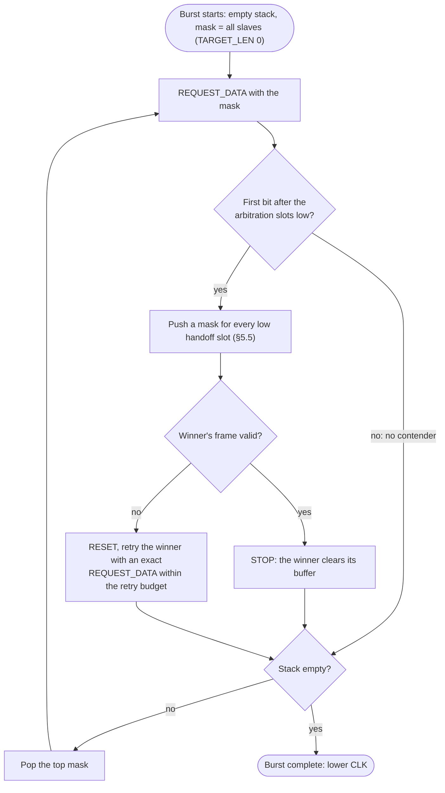
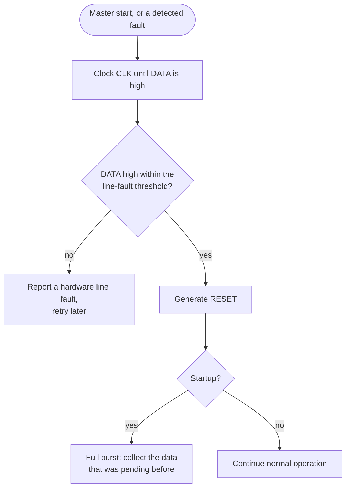
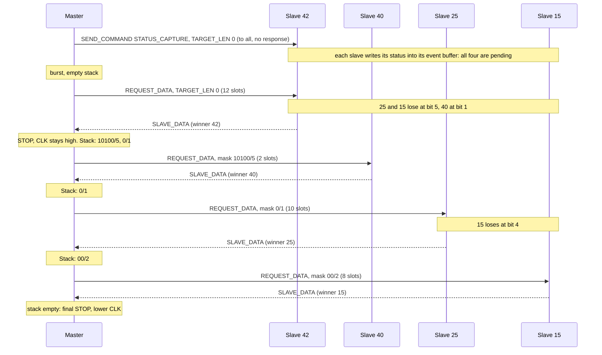

# 6. Operation

This chapter describes the procedures the master runs on top of the transactions: collecting events, reading states, finding slaves, and bringing the bus into a defined state. All of them are master-side; a slave only reacts to clock edges and line conditions ([§7.6](07-slave.md#76-no-timeouts)).

## 6.1 Idle Event Handshake

A slave with pending data ([§4.8](04-frames.md#48-event-buffer)) tells the master on its own; this is the only time a slave speaks without being asked.

1. The slave pulls `DATA` low while the bus is idle with `CLK` low ([§2.3](02-line-conditions.md#23-bus-idle)).
2. The master sees `DATA` low while idle and confirms with clock pulses, watching `DATA`.
3. The slave releases `DATA` after the first falling `CLK` edge, that is after one complete clock pulse; releasing while `CLK` is high would look like a STOP. Several slaves that signal at the same time all release after that pulse.
4. The master starts a burst ([§6.2](#62-burst)) with a START.

**When a slave announces itself.** A slave pulls `DATA` low in exactly two situations, both with the bus idle and `CLK` low:

1. The event buffer is written while no data was pending (the pending flag changes from 0 to 1). Overwriting data that is already pending does not signal again.
2. At the first falling `CLK` edge after a STOP or RESET, if data is still pending. This is how a slave that was skipped in a burst, or whose buffer was written during a transaction, announces itself again.

A slave signals at most once per STOP: not again on the clock pulses of a handshake, and never on a falling edge that follows a START. Without this rule, pending slaves in different phases would keep each other's signals alive and the master could never see `DATA` released. Inside a burst `CLK` stays high between the transactions, so nobody signals there at all ([§2.4](02-line-conditions.md#24-back-to-back-transactions)).

**Master side.**

- Before every START or RESET with `CLK` low, the master checks `DATA`. If it is low, it runs the handshake first.
- After raising `CLK` for the condition, it checks `DATA` once more. A slave that started signaling just before `CLK` rose holds `DATA` low ([§8.3](08-faults.md#83-event-signal-races-with-start)). The master completes the clock pulse, which releases the slave, runs the recovery sequence ([§6.6](#66-startup-shutdown-and-recovery)), and repeats the transaction.
- If `DATA` stays low beyond the line-fault threshold, the master reports a line fault ([§6.6](#66-startup-shutdown-and-recovery)).
- The slave has no timeout: without a running master it keeps `DATA` low indefinitely. This is harmless; the startup sequence resolves it ([§6.6](#66-startup-shutdown-and-recovery)).

## 6.2 Burst

A burst collects the data of every slave that is pending when it starts, in descending MCID order, with exactly one transaction per slave: a group `REQUEST_DATA` whose winner sends its data directly ([§5](05-arbitration.md)).

1. Start with an empty pending mask stack and send `REQUEST_DATA` with `TARGET_LEN = 0`.
2. If the first bit after the arbitration slots is high, the group has no pending slave. Otherwise the winner is the group prefix followed by the sampled arbitration bits, and the master pushes one mask per low handoff slot ([§5.5](05-arbitration.md#55-pending-masks)).
3. The winner's frame follows in the same transaction. If it is valid, the master ends with STOP and the winner clears its buffer ([§3.6](03-transactions.md#36-transaction-end-and-buffer-clearing)). If not, it ends with RESET and retries the winner with an exactly addressed `REQUEST_DATA`; the masks are already on the stack.
4. While the stack is not empty, pop the top mask and continue with step 2. A mask with `TARGET_LEN = 6` is a plain exact request.

Properties:

- All transactions of a burst are back-to-back with `CLK` held high ([§2.4](02-line-conditions.md#24-back-to-back-transactions)). The master lowers `CLK` only after the final STOP; slaves that are still or again pending then announce themselves ([§6.1](#61-idle-event-handshake)).
- Every slave pending at the start is served in this burst. A higher-priority slave that becomes pending again during the burst lies outside the remaining masks and is served in the next burst, so lower-priority slaves are not starved.
- The slave's effort is one extra pulled slot, the handoff slot directly after losing.
- A failed slave is retried within a small configured budget and then skipped for this burst. Its data stays buffered, and it announces itself again later.
- A wrongly read handoff slot only wastes a request or delays a slave to the next burst ([§8.5](08-faults.md#85-handoff-slot-errors)).
- After a valid fragment with `MORE = 1` the master may ask the same slave again at once ([§4.11](04-frames.md#411-fragments)).

[§5.6](05-arbitration.md#56-example-four-pending-slaves) walks through a burst with four slaves; [§6.7](#67-example-status-capture-and-burst) shows it as a sequence.

## 6.3 Reading States

- An exactly addressed `REQUEST_STATE` reads the live state of one slave at any time, in one transaction ([§4.10](04-frames.md#410-state)). Nothing is cleared, so it can be repeated freely; it does not disturb pending events.
- A group `REQUEST_STATE` (for example `TARGET_LEN = 0`) enumerates the states of all slaves that have one, one transaction per slave, with the same mask stack algorithm as a burst ([§6.2](#62-burst)).
- A slave without an event buffer never announces a change. A master that needs current values polls its state (for example `poll_interval_s` in [hubusd](../daemon.md#slaves-that-never-announce-changes-poll_interval_s)).
- A slave without a state can still be read with `STATUS_CAPTURE` followed by a burst. That takes more transactions and goes through the event buffer, where the captured status may overwrite an unread event ([§4.8](04-frames.md#48-event-buffer)).
- A slave with neither a state nor an event buffer cannot be read at all; the master keeps the state it commanded ([§8.8](08-faults.md#88-commands-without-readback)).

## 6.4 Commissioning Scan and Duplicate MCIDs

Duplicate MCIDs are a configuration fault. Only the master detects them; slaves implement no detection logic.

**Commissioning scan.** The master enumerates the slaves with group `REQUEST_INFO`, using the burst algorithm ([§6.2](#62-burst)) with `REQUEST_INFO` instead of `REQUEST_DATA`. Every matching slave contends, so the winner's `SLAVE_INFO` arrives in the same transaction: about one transaction per slave, and empty MCID groups are never visited.

- A valid `SLAVE_INFO`: the slave is present; its protocol version and capabilities are known ([§4.7](04-frames.md#47-slave-info-slave_info)).
- No contender: no slave in that group.
- Repeated CRC failures for a winner: suspected duplicate MCID or a line problem. The master repeats the request for that MCID with exact addressing within its retry budget.

Two slaves with the same MCID win an arbitration together and both send their frame; the overlapping frames fail the CRC if their contents differ. With a device-unique value in `SLAVE_INFO` ([§4.7](04-frames.md#47-slave-info-slave_info)) the scan therefore detects duplicates reliably.

A single MCID can be checked at any time with an exactly addressed `REQUEST_INFO`. There is no procedure that asks all 63 MCIDs one by one.

**Runtime heuristic.** If the same MCID fails the CRC repeatedly while other MCIDs answer cleanly, the master reports a suspected duplicate MCID; repeated failures of many MCIDs point to a line problem instead. Blind spots are described in [§8.7](08-faults.md#87-duplicate-mcid-blind-spots).

## 6.5 Communication Stack Reset

RESET ([§2.1](02-line-conditions.md#21-conditions)) resets the communication stack of every slave:

| Reset | Preserved |
|---|---|
| protocol state (back to idle) | event buffer content |
| receive position, partial frame | generation counter `GEN` |
| arbitration state | pending flag |
| transmit position, partial response | static device info, MCID, application state |
| `DATA` driver (released) | |

Because the pending flag survives, a slave with unread data announces itself again after the reset ([§6.1](#61-idle-event-handshake)).

## 6.6 Startup, Shutdown, and Recovery

**Startup (mandatory).**

1. Clock `CLK` until `DATA` is high. A slave that is still transmitting or arbitrating finishes within one maximum frame length; a slave that signals an event releases on the confirmation pulses.
2. If `DATA` is still low after the line-fault threshold (at least one maximum frame length in clock ticks), report a hardware line fault.
3. Generate RESET ([§6.5](#65-communication-stack-reset)).
4. Run a full burst ([§6.2](#62-burst)) for the data that was pending before.

**Recovery.** Whenever the master detects a fault (missing or invalid response, MCID mismatch, unexpected line state), it runs steps 1–3 and continues. Since every START resynchronizes the slaves anyway ([§2.5](02-line-conditions.md#25-resynchronization)), the explicit RESET matters mainly where a slave may still be transmitting or arbitrating.

**Shutdown (optional).** The master SHOULD generate RESET before it stops, leaving every slave idle with `DATA` released. Slaves do not depend on this, since the master may stop unexpectedly ([§8.9](08-faults.md#89-master-stops-mid-transaction)).

## 6.7 Example: Status Capture and Burst

The four slaves of [§5.6](05-arbitration.md#56-example-four-pending-slaves) support `STATUS_CAPTURE`. The master asks all of them for their status and collects it in one burst:

- The capture command reaches all four slaves; none of them answers it ([§4.5](04-frames.md#45-addressing)). Slaves without `STATUS_CAPTURE` or without event buffer ignore the opcode ([§4.4](04-frames.md#44-command-opcodes)).
- Each request goes to the group of its mask, and only pending slaves of that group contend; the arrows point to the winner.
- A captured status may still be overwritten by a newer write before the master collects it; the master sees that as a `GEN` gap ([§4.9](04-frames.md#49-generation-counter-gen)).
