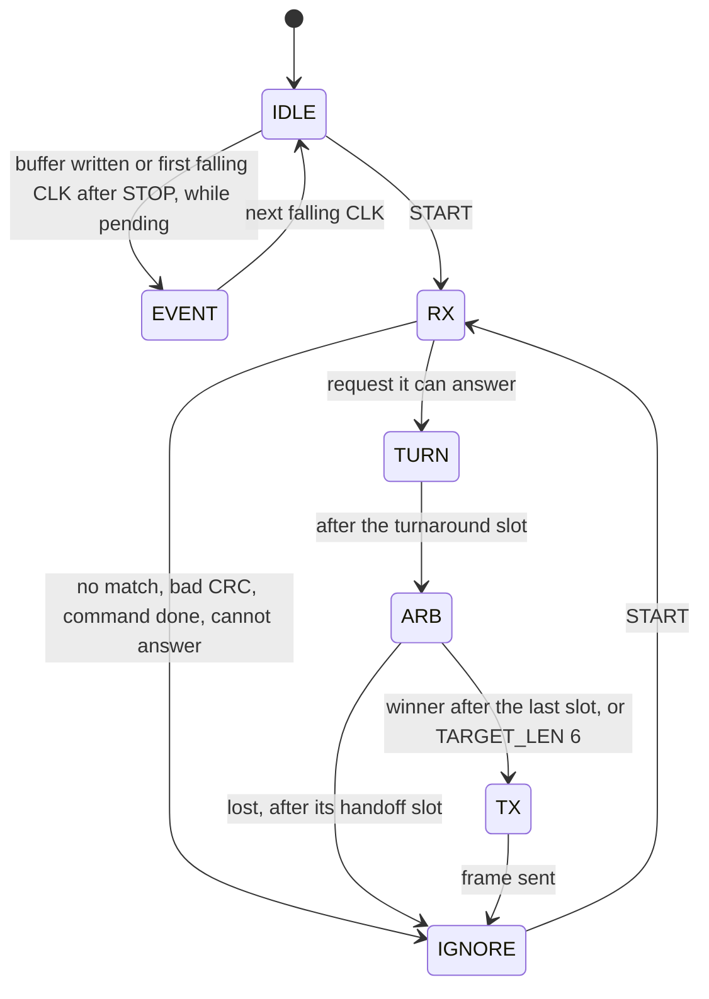

# 7. Slave Requirements

What a compliant slave has to do, collected from the chapters before, and how the HUBUS slave library structures it. The library itself is described in [slave library](../slave-library.md).

## 7.1 Responsibilities

A compliant slave:

- samples `DATA` on the rising `CLK` edge and changes `DATA` only while `CLK` is low ([§1.3](01-physical-layer.md#13-bit-transfer));
- detects START, STOP, and RESET, restarts reception at bit 0 on every START, and releases `DATA` on every line condition ([§2.1](02-line-conditions.md#21-conditions));
- reads `TYPE` and `TARGET_LEN` first and drops a frame as soon as the prefix cannot match ([§4.5](04-frames.md#45-addressing));
- receives every frame to its end (header, `LEN` payload bytes, CRC8), also payload it does not use, and computes the CRC8 incrementally ([§3.5](03-transactions.md#35-slave-processing-budget), [§4.12](04-frames.md#412-integrity-check-crc8));
- acts on a frame only with a valid CRC8;
- answers only a request it can answer, exactly addressed or as the winner of the arbitration ([§4.5](04-frames.md#45-addressing)), and never a command;
- takes part in the arbitration, including the handoff slot directly after losing ([§5.3](05-arbitration.md#53-slot-sequence));
- transmits `MORE` and `GEN` in event frames and `000` in their place in `SLAVE_INFO` and state frames ([§4.1](04-frames.md#41-frame-structure));
- with an event buffer: announces pending data on the idle bus ([§6.1](06-operation.md#61-idle-event-handshake)) and clears the buffer only after a complete response and the following STOP ([§3.6](03-transactions.md#36-transaction-end-and-buffer-clearing));
- ignores unknown reserved opcodes and commands longer than it accepts ([§4.4](04-frames.md#44-command-opcodes));
- with a blind class: begins a blind section only while it drives nothing, ends it within the announced time, and resynchronizes at its end ([§7.8](#78-blind-sections));
- has no timeouts ([§7.6](#76-no-timeouts)).

## 7.2 MCID

- Every slave has an MCID `1..63`, unique on the bus and fixed at runtime. MCID `0` is reserved ([§4.5](04-frames.md#45-addressing)).
- A duplicate MCID is a configuration fault that only the master detects ([§6.4](06-operation.md#64-commissioning-scan-and-duplicate-mcids)). The application bytes of `SLAVE_INFO` SHOULD contain a device-unique value, such as a serial number ([§4.7](04-frames.md#47-slave-info-slave_info)).

## 7.3 State Machine

The state names are those of the slave library (`HUBUS_ST_*` in `core/hubus_slave_core.h`).

START leads from every state to `RX`; STOP and RESET lead from every state to `IDLE`. The end of a blind section leads to `IGNORE` ([§7.8](#78-blind-sections)). The diagram leaves these transitions out.

| State | Behavior |
|---|---|
| `IDLE` | Wait for START. With pending data and the bus idle, announce it ([§6.1](06-operation.md#61-idle-event-handshake)). |
| `EVENT` | Hold `DATA` low until the next falling `CLK` edge ([§6.1](06-operation.md#61-idle-event-handshake)). Only with an event buffer. |
| `RX` | Receive the master frame. A prefix mismatch is detected as the bits arrive. With the CRC8 byte the frame is evaluated: CRC result, execution of a command, and whether the slave can answer a request ([§5.2](05-arbitration.md#52-contenders)). |
| `TURN` | Turnaround slot with `DATA` released ([§3.2](03-transactions.md#32-turnaround-slot)). Only a slave that answers or contends gets here. |
| `ARB` | Arbitration from slot `2·TARGET_LEN` on ([§5.3](05-arbitration.md#53-slot-sequence)). A slave that loses at bit `k` remembers `k`, pulls `DATA` low in handoff slot `k`, and is then passive for the rest of the pattern. |
| `TX` | Transmit `SLAVE_INFO` or `SLAVE_DATA` (event buffer or state). |
| `IGNORE` | Not addressed, invalid frame, nothing to send, lost the arbitration, or response complete: passive until the next START, STOP, or RESET. |

| Line condition | Slave action, from any state |
|---|---|
| START | Release `DATA`, discard any partial frame, arbitration, or transmission, and receive from bit 0. |
| STOP | Release `DATA`, go to `IDLE`. After a complete `SLAVE_DATA` response to `REQUEST_DATA` in this transaction, clear the pending flag, which empties the event buffer ([§3.6](03-transactions.md#36-transaction-end-and-buffer-clearing)). Arm the announcement at the next falling edge ([§6.1](06-operation.md#61-idle-event-handshake)). |
| RESET | Release `DATA`, reset the communication stack, go to `IDLE`; buffer, `GEN`, and pending flag are kept ([§6.5](06-operation.md#65-communication-stack-reset)). |

There is no recovery state in a slave: after a CRC failure or a frame that does not match, it ignores the rest and waits for the next START.

## 7.4 Optional Parts

The event buffer ([§4.8](04-frames.md#48-event-buffer)) and the state ([§4.10](04-frames.md#410-state)) are independent, optional parts of a slave. The application chooses them per device type, and `SLAVE_INFO` byte 1 tells the master which ones a slave has ([§4.7](04-frames.md#47-slave-info-slave_info)). Every combination is valid:

| Event buffer | State | Typical device | How the master learns the state |
|---|---|---|---|
| yes | yes | push button, multi-button panel | events in bursts, `REQUEST_STATE` at any time |
| yes | no | simple event source | events in bursts, `STATUS_CAPTURE` |
| no | yes | sensor that is only read, relay with readback | `REQUEST_STATE`; the master polls if it needs current values ([§6.3](06-operation.md#63-reading-states)) |
| no | no | relay without feedback | not at all: the master keeps the state it commanded in a cache ([§8.8](08-faults.md#88-commands-without-readback)) |

- **Without the event buffer** the slave never speaks on its own: no idle event signaling, no `REQUEST_DATA` response (it behaves like a slave with an empty buffer), and `STATUS_CAPTURE` is ignored.
- **Without the state** the slave ignores `REQUEST_STATE`.
- **Without both** the slave only executes commands and answers `REQUEST_INFO`.

The slave library makes both parts build options; their cost in flash and RAM is listed in [slave library: optional parts](../slave-library.md#optional-parts).

**Firmware update** is a third optional part, independent of the two above ([§6.8](06-operation.md#68-firmware-update)). It consists of the updater, a second firmware that stays on the device, and, in the application, the switch to it on `UPDATE_ENTER` (capability bit 3). It costs the flash of the updater, about 2 KB, which is why it suits devices with 8 KB of flash or more; smaller devices leave it out and are programmed in-system as before.

## 7.5 Buffers and Resources

- A receive buffer for command payloads and, with the event buffer, exactly one outgoing buffer. Both sizes are build options of at most 31 bytes; the accepted command size is announced in `SLAVE_INFO` byte 2 ([§4.7](04-frames.md#47-slave-info-slave_info)).
- Static device info can live in flash; the state is read from the application while transmitting and needs no buffer ([§4.10](04-frames.md#410-state)).
- No dynamic memory. Every interrupt runs a short, bounded amount of work.

## 7.6 No Timeouts

A slave has no time base of its own and no timeouts, timers, or retry counters. Every state change is caused by a `CLK` edge or a line condition. A slave therefore

- releases `DATA` and resynchronizes on every START, and releases it on STOP and RESET;
- finishes any transmission within the bit count of its frame, since it only advances on clock edges, and can never block the bus for longer than one frame;
- stays in its current state when the clock stops. The master resolves this with its startup sequence ([§6.6](06-operation.md#66-startup-shutdown-and-recovery)).

All timeouts, retries, fault detection, and recovery are master-side.

## 7.7 Implementation Notes

- The protocol logic lives in a hardware-independent core shared by all devices and by the host tests; each device family has a small hardware abstraction layer for the pins and interrupts.
- Both `CLK` and `DATA` raise pin change or edge interrupts. The handler compares the pins with their previous levels: a `CLK` edge is a bit event, a `DATA` change while `CLK` is high is START or STOP, and a `DATA` change while `CLK` is low (including the slave's own writes) is ignored.
- Callbacks into the application (command, status capture) run in the interrupt handler and must be short.

## 7.8 Blind Sections

Some applications have to run timing-critical code with all interrupts disabled for longer than their speed class allows, for example a slave that sends a frame to a WS2812 LED strip (1.25 µs per bit, accurate to about 150 ns). Such a slave MAY become **blind** after a command addressed to it: for a bounded time it handles no `CLK` or `DATA` edges at all. The master keeps away from it for that time ([§6.9](06-operation.md#69-blind-time-after-a-command)); the rest of the bus goes on.

**Blind class.** `SLAVE_INFO` byte 3, bits 7–4, announces the longest blind time, counted from the STOP of the command transaction to the end of the blind section ([§4.7](04-frames.md#47-slave-info-slave_info)):

| Class | 0 | 1 | 2 | 3 | 4 | 5 | 6 | 7 | 8 | 9 | 10 | 11 | 12 | 13 | 14 | 15 |
|---|---|---:|---:|---:|---:|---:|---:|---:|---:|---:|---:|---:|---:|---:|---:|---:|
| Blind time at most (ms) | never blind | 0.25 | 0.5 | 1 | 2 | 4 | 8 | 16 | 32 | 64 | 128 | 256 | 512 | 1024 | 2048 | 4096 |

- Class `k` allows `0.25 ms · 2^(k−1)`. Like the speed class, the scale is coarse on purpose.
- The class is a property of the firmware. It applies to every command addressed to the slave, exactly or through a group, including `STATUS_CAPTURE`; the master cannot know which opcodes make the slave blind.
- A slave with class `0` is never blind. This is the default, and every slave that does not need it declares `0`.

**Rules for the slave.**

1. A blind section begins only while the slave drives nothing and owes nothing: between transactions or while it receives a frame, never while it signals an event, contends, or transmits. In the slave library these are the states `IDLE`, `RX`, and `IGNORE` ([§7.3](#73-state-machine)).
2. It ends at the latest when the announced blind time after the STOP of the command has passed.
3. At its end the slave **resynchronizes**: it takes the current levels of `CLK` and `DATA` as the reference for the next edge, releases `DATA`, and goes to `IGNORE` until the next START, STOP, or RESET.

The third rule is what keeps the rest of the bus safe. The slave tells line conditions from bits by comparing the pins with the levels it saw last ([§7.7](#77-implementation-notes)). With the levels from before the blind section, the first `DATA` change after it could look like a START in the middle of somebody else's frame. The slave would then read the following bits as a header, and if that header passes the CRC by chance, it could execute a command that was never sent or contend in a handoff slot of a foreign arbitration. In `IGNORE` it cannot do either, and every START brings it back in step ([§2.5](02-line-conditions.md#25-resynchronization)).

A slave that became pending during a blind section stays in `IGNORE` on an idle bus and announces itself only after the next STOP or RESET ([§6.1](06-operation.md#61-idle-event-handshake)). The master ends every blind time with a transaction or a RESET, so the announcement is only delayed.

A blind section is not a timeout in the sense of [§7.6](#76-no-timeouts): the protocol logic still changes state only on edges and line conditions. The length of the section is a property of the application code, which the slave declares so that the master can plan around it.
